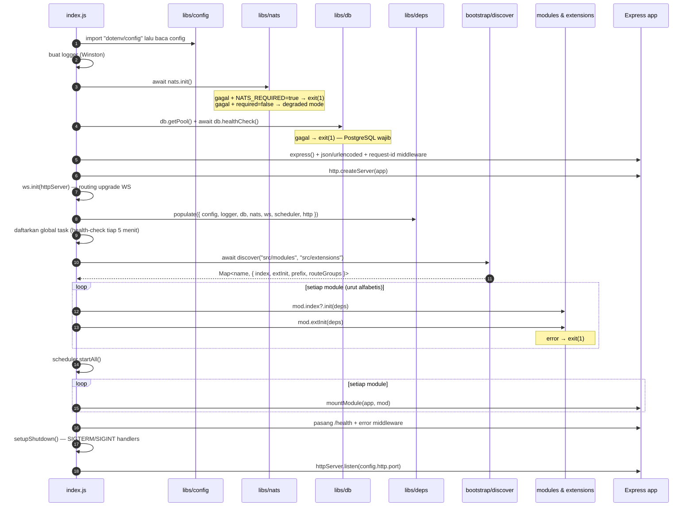
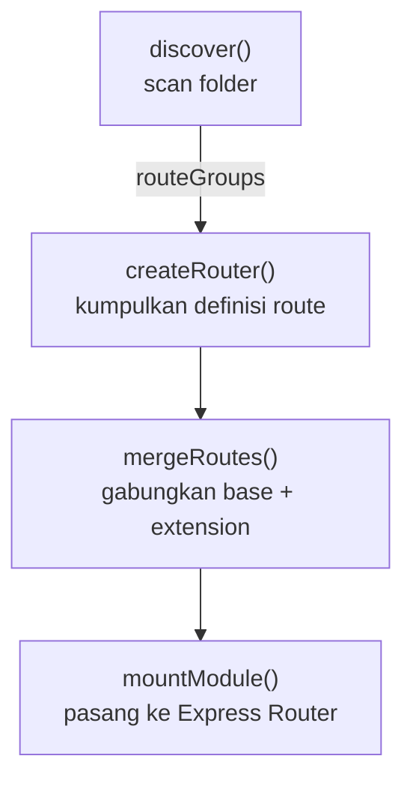
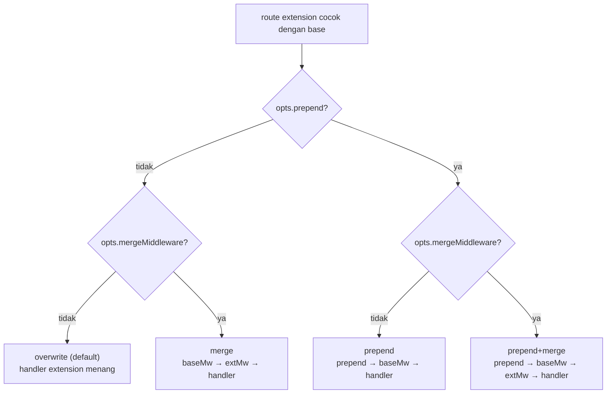
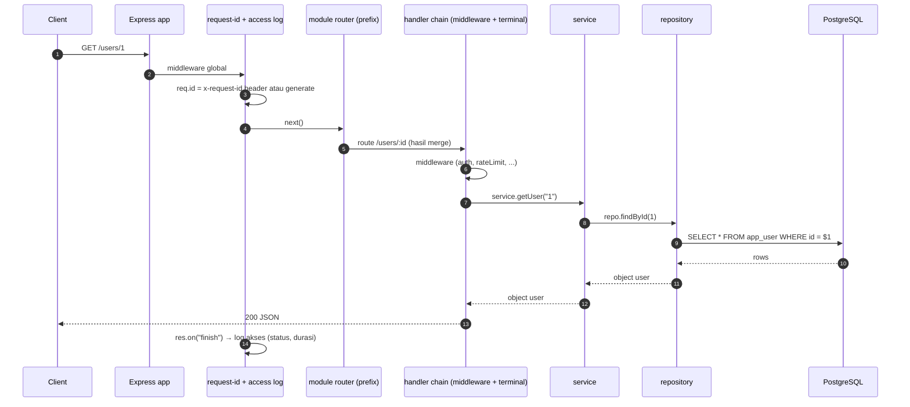
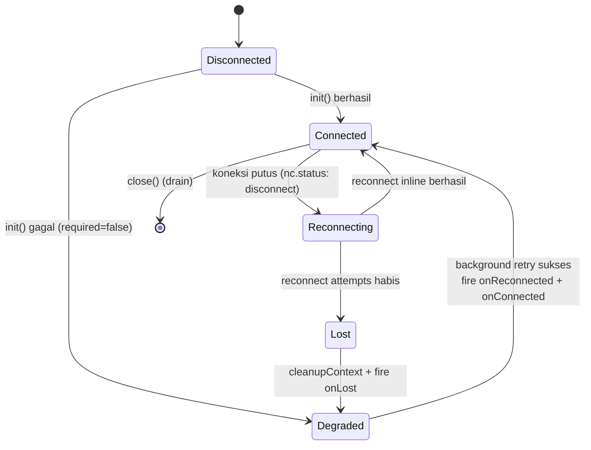
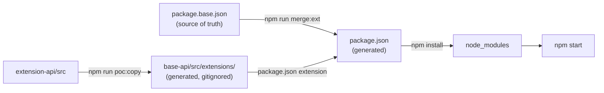
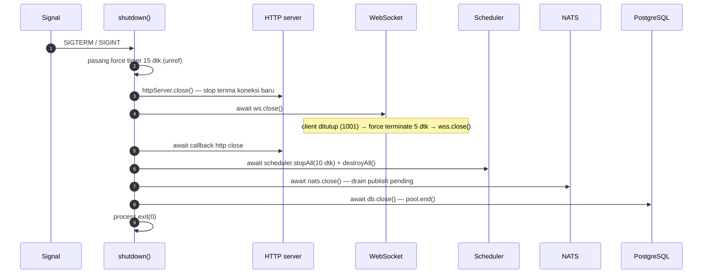

# ARCHITECTURE — base-api & extension-api

> **Bahasa Indonesia | [English](./en/ARCHITECTURE.md)**

> **Dokumen ini menjawab:** "Bagaimana sistem ini bekerja, dan kenapa didesain begitu?"
> Untuk aturan yang tidak boleh dilanggar, baca [CONTRACT.md](./CONTRACT.md).
> Untuk langkah praktik menulis kode, baca [DEVELOPER-GUIDE.md](./DEVELOPER-GUIDE.md).

**Audiens:** developer yang paham JavaScript dasar + `async/await`, tetapi belum pernah memakai Express, NATS, atau WebSocket.

**Versi kode yang didokumentasikan:** branch `feature/express5-esm` — ESM, Express 5, istilah **module** (sebelumnya "feature").

---

## Daftar Isi

1. [Apa itu base-api & extension-api](#1-apa-itu-base-api--extension-api)
2. [Peta Konsep](#2-peta-konsep)
3. [Bootstrap Lifecycle](#3-bootstrap-lifecycle)
4. [Composition Pipeline](#4-composition-pipeline)
5. [Request Lifecycle](#5-request-lifecycle)
6. [Shared Infrastructure Clients](#6-shared-infrastructure-clients)
7. [Build Pipeline](#7-build-pipeline)
8. [Graceful Shutdown](#8-graceful-shutdown)
9. [Batasan Desain Saat Ini (POC)](#9-batasan-desain-saat-ini-poc)

---

## 1. Apa itu base-api & extension-api

Bayangkan sebuah produk SaaS yang dipakai banyak klien. 90% kode sama untuk semua klien, tetapi tiap klien minta hal kecil yang berbeda: endpoint tambahan, validasi lebih ketat, format response berbeda.

Pendekatan umum (fork per klien) menyebabkan: bug fix harus di-copy ke semua fork, dan fork perlahan bercabang menjadi produk berbeda.

**base-api** adalah satu aplikasi inti. **extension-api** adalah repo terpisah yang berisi *hanya kustomisasi klien*. Saat build, isi extension **disalin** ke dalam base (`src/extensions/`), lalu base menyusun (compose) module inti + ekstensi menjadi satu aplikasi yang berjalan.

```text
┌────────────────────┐      ┌────────────────────┐
│  base-api          │      │  extension-api     │
│  (produk inti)     │      │  (kustomisasi)     │
│  src/modules/      │      │  src/              │
│    user-management │◄─────│    user-management │  ← override / tambahan
│    product-manag.  │ copy │    product-manag.  │
└────────────────────┘      │    audit-user      │  ← module baru (extension-only)
        │                   └────────────────────┘
        ▼
  satu aplikasi Express yang berjalan
```

Keuntungan:
- **Kode inti tetap satu.** Bug fix cukup di base-api.
- **Kustomisasi terisolasi.** Perbedaan klien terkumpul di satu repo extension.
- **Kontrak jelas.** Extension hanya boleh berinteraksi lewat aturan yang didokumentasikan di [CONTRACT.md](./CONTRACT.md).

> ⚠️ Ini bukan plugin system runtime. Komposisi terjadi saat **build** (file disalin + digabung), bukan saat aplikasi berjalan.

---

## 2. Peta Konsep

Empat istilah yang akan terus muncul:

| Istilah | Arti | Contoh |
| --- | --- | --- |
| **Module** | Satu potongan fitur lengkap: HTTP routes, service, repository, dan init hook opsional | `user-management`, `product-management` |
| **Extension** | Kode kustomisasi yang menempel pada module (menimpa/menambah route, middleware, init) atau membuat module baru khusus klien | `route.user.extend.js`, `audit-user` |
| **Shared libs** (`src/libs/`) | Infrastruktur bersama: config, logger, database, NATS, WebSocket, scheduler, dan mesin komposisi route | `src/libs/db.js` |
| **deps** | Kantong dependency bersama yang di-inject ke semua module saat bootstrap | `{ config, logger, db, nats, ws, scheduler, http }` |

### Struktur folder base-api

```text
express-modular-sample/
├── index.js                     # entry point: seluruh bootstrap
├── package.base.json            # source of truth dependencies & scripts
├── package.json                 # GENERATED — jangan edit manual
├── scripts/
│   ├── merge-package.js         # gabung package.base.json + extension
│   └── copy-extensions.js       # salin extension-api/src → src/extensions/
├── src/
│   ├── libs/                    # infra + mesin komposisi
│   │   ├── config.js            # baca environment variables
│   │   ├── logger.js            # Winston
│   │   ├── deps.js              # kantong dependency (live bindings)
│   │   ├── db.js                # PostgreSQL pool + query/tx/insert
│   │   ├── nats.js              # NATS + JetStream + reconnection
│   │   ├── ws.js                # WebSocket server + channel registry
│   │   ├── scheduler.js         # cron tasks
│   │   ├── routeCollector.js    # "router" palsu pengumpul definisi route
│   │   ├── mergeRoutes.js       # mesin merge base + extension
│   │   ├── mountModule.js       # pasang hasil merge ke Express
│   │   └── bootstrap/discover.js# scan folder → daftar module
│   ├── modules/                 # module inti (produk)
│   │   ├── user-management/
│   │   └── product-management/
│   └── extensions/              # GENERATED (gitignored) — hasil copy
│       ├── user-management/     # file *.extend.js + init.extend.js
│       ├── product-management/
│       └── audit-user/          # extension-only module
└── test/                        # node:test
```

### Struktur folder extension-api

```text
express-modular-extension-sample/
├── package.json                 # hanya deklarasikan dependency tambahan (uuid)
└── src/
    ├── user-management/         # kustomisasi module user-management
    │   ├── route.user.extend.js
    │   ├── middleware.extend.js
    │   ├── service.helper.js
    │   └── init.extend.js
    ├── product-management/
    │   ├── route.product.extend.js
    │   └── route.policy.extend.js
    └── audit-user/              # extension-only module (module baru milik klien)
        ├── index.js
        ├── routes/
        ├── services/
        └── repositories/
```

**Perhatikan:** di extension, file route bernama `route.<group>.extend.js` (bukan `route.<group>.js`). Nama file inilah yang memberi tahu `discover()` bahwa file tersebut adalah *extension*, bukan base route.

---

## 3. Bootstrap Lifecycle

Seluruh urutan startup ada di `index.js` dalam fungsi `main()`. Urutannya **tidak boleh diacak** — beberapa langkah bergantung pada langkah sebelumnya.



Poin penting yang sering ditanyakan pemula:

1. **`import "dotenv/config"` harus dieksekusi lebih dulu** supaya `process.env` sudah terisi saat `config.js` dievaluasi. Itulah kenapa ia ditulis di baris pertama `index.js`.
2. **NATS opsional, PostgreSQL wajib.** Kalau NATS tidak tersedia, aplikasi tetap jalan dalam *degraded mode* (fitur berbasis NATS mati, sisanya hidup). Kalau PostgreSQL tidak tersedia, aplikasi menolak start.
3. **`populate(deps)` terjadi SEBELUM `discover()`.** Module-module di-load secara dinamis oleh `discover()`; saat itu mereka membaca `deps`. Kegagalan urutan ini adalah penyebab error `Cannot read properties of null` yang klasik.
4. **Urutan init module mengikuti nama folder (alfabetis)** — `audit-user` → `product-management` → `user-management`. Jangan mengandalkan urutan ini untuk saling ketergantungan antar module.
5. **Routes dipasang paling akhir**, setelah semua init hook. Jadi kalaupun init hook melempar error, app langsung exit dan tidak pernah menerima trafik setengah jadi.

---

## 4. Composition Pipeline

Ini jantung sistem: bagaimana file-file route dari module dan extension menjadi satu router Express. Terdiri dari empat tahap.



### 4.1 Discovery (`src/libs/bootstrap/discover.js`)

`discover()` memindai dua folder:

- `src/modules/<name>/routes/` — route inti
- `src/extensions/<name>/` dan `src/extensions/<name>/routes/` — route extension

Nama file menentukan perannya:

| Nama file | Peran |
| --- | --- |
| `route.user.js` | Base route untuk grup bernama `user` |
| `route.user.extend.js` | Extension untuk grup `user` |
| `index.js` | Metadata module: `{ prefix, init }` |
| `init.extend.js` | Init hook khusus extension |

Hasil akhirnya adalah `Map` berisi descriptor tiap module:

```js
{
  name: "user-management",
  index: { prefix: "/users", init(deps) { ... } },  // dari index.js (module atau extension-only)
  extInit: async function initUserExt(deps) { ... }, // dari init.extend.js (opsional)
  prefix: "/users",                                  // dari index.prefix, fallback "/<name>"
  routeGroups: [ { groupName: "user", baseRegister, extendRegister } ]
}
```

### 4.2 Route Collector (`src/libs/routeCollector.js`)

`createRouter()` bukan Express Router. Ia hanya objek pengumpul: setiap panggilan `r.get(path, ...handlers)` dicatat sebagai `{ method, path, handlers, opts }` tanpa langsung dipasang ke Express. Ini yang membuat route bisa di-*merge* sebelum menjadi router sungguhan.

### 4.3 Merge Engine (`src/libs/mergeRoutes.js`)

Base route dan extension route dicocokkan berdasarkan kunci `"<method> <path>"`. Empat mode merge:



Aturan yang perlu dipahami:

- **Handler terakhir** dari sebuah definisi route dianggap sebagai *terminal handler* (yang mengirim response); sisanya dianggap *middleware*.
- `prepend` menyisipkan middleware **sebelum** semua middleware base.
- `mergeMiddleware: true` menyisipkan middleware extension **setelah** middleware base (tetap sebelum handler).
- Tanpa opsi apapun → **overwrite**: handler extension menggantikan handler base sepenuhnya.
- Route extension yang tidak punya pasangan di base → `_mode: "new"`.

Contoh dari sample repo (lihat hasil cetak route table saat start):

```text
Module: user-management  →  /users
    [role]
      GET     /users/roles
    [user]
      GET     /users
      GET     /users/:id [overwrite]     ← route.user.extend.js menimpa GET /users/:id
      DELETE  /users/:id [new]           ← route baru dari extension
```

### 4.4 Mount (`src/libs/mountModule.js`)

Tahap terakhir: hasil merge dipasang ke satu `express.Router()` per module, lalu router itu di-`app.use(prefix, router)`. Setiap route yang terpasang dicetak ke console supaya developer bisa langsung melihat mode merge yang terjadi.

> ⚠️ Karena Express mencocokkan route secara **berurutan** (first match), urutan route berpengaruh. Detail dan aturannya ada di [CONTRACT.md §3](./CONTRACT.md#3-route-merge-contract).

---

## 5. Request Lifecycle

Setelah aplikasi berjalan, apa yang terjadi ketika ada HTTP request masuk?



Lapisan-lapisan aplikasi:

| Lapisan | Tanggung jawab | Contoh |
| --- | --- | --- |
| Route | Terima HTTP request, panggil service, kirim response | `route.user.js` |
| Middleware | Auth, validasi, rate limit, logging (boleh menghentikan request) | `middleware.extend.js` |
| Service | Logika bisnis, aturan, orkestrasi | `service.user.js` |
| Repository | Akses database (SQL) | `repo.user.js` |

**Error handling:** Express 5 otomatis meneruskan error dari handler `async` ke error middleware global (tanpa `try/catch` pun tidak akan menggantung). Error middleware mencatat log dan mengirim `500 { "error": "internal error" }`. Route yang punya skenario "tidak ditemukan" tetap menangani sendiri dan mengembalikan `404 { "error": "User not found" }`.

---

## 6. Shared Infrastructure Clients

Semua module mengakses infra melalui `deps` — bukan dengan membuat koneksi sendiri. Ini menjaga agar hanya ada satu pool database, satu koneksi NATS, satu WebSocket server, dan satu scheduler di seluruh proses.

### 6.1 deps — live bindings

`src/libs/deps.js` mengekspor binding hidup:

```js
export let db = null;          // ← nilai awal
export function populate(values) { /* mengisi binding di atas */ }
```

Modul konsumen menulis `import { db } from ".../libs/deps.js"` lalu memakai `db.query(...)` **di dalam body function**. Karena binding-nya hidup, saat `populate()` dipanggil dari `index.js`, semua modul otomatis melihat nilai terbaru — tanpa perlu `require` ulang atau injeksi manual.

Aturan lengkapnya ada di [CONTRACT.md §4](./CONTRACT.md#4-deps-contract).

### 6.2 PostgreSQL (`src/libs/db.js`)

- `getPool()` — membuat `pg.Pool` saat pertama dipanggil (lazy), dengan max connections, idle timeout, dan connection timeout dari config.
- `query(sql, params)` — wrapper `pool.query` dengan logging durasi + rowCount, error di-rethrow setelah dicatat.
- `tx(fn)` — transaksi: `BEGIN` → `fn(client)` → `COMMIT`, `ROLLBACK` jika error, `client.release()` selalu.
- `insert(table, row)` — helper insert dinamis: kolom diambil dari key object, value di-parameterisasi (`$1, $2, ...`), nama tabel/kolom divalidasi dengan regex identifier (mencegah SQL injection lewat nama kolom), dan mengembalikan baris hasil (`RETURNING *`).
- `healthCheck()` — `SELECT 1`, dipakai saat bootstrap dan endpoint `/health`.

### 6.3 NATS + JetStream (`src/libs/nats.js`)

NATS dipakai untuk komunikasi event antar-module (`user.created`, dsb). Modul ini punya state machine reconnection yang cukup kaya:



Callback yang disediakan:

| Callback | Kapan dipanggil | Kegunaan |
| --- | --- | --- |
| `onConnected(fn)` | Setiap kali koneksi sukses (awal **dan** setelah background retry) | (re-)subscribe |
| `onLost(fn)` | Koneksi hilang permanen setelah semua retry habis | log, metrik, tandai degraded |
| `onReconnected(fn)` | Background retry berhasil | pemulihan khusus |

**Kenapa pola re-subscribe penting?** Setelah reconnect lewat background retry, subscription lama sudah mati bersama koneksi lama. Karena itu setiap module mendaftarkan fungsi `setup()` yang idempoten ke `onConnected` — pola lengkapnya di [CONTRACT.md §6](./CONTRACT.md#6-nats-contract) dan tutorial di [DEVELOPER-GUIDE.md](./DEVELOPER-GUIDE.md).

Publish dua mode:
- `publish(subject, payload)` — core NATS, fire-and-forget, return `false` jika tidak tersedia.
- `jsPublish(subject, payload)` — JetStream, dapat acknowledgment, return `null` jika gagal.

### 6.4 WebSocket (`src/libs/ws.js`)

Satu `WebSocketServer` dengan `noServer: true`; routing dilakukan manual berdasarkan path URL saat upgrade:

- `register(path, handler, { owner })` — daftarkan channel. **Throw jika path sudah terdaftar** (mencegah bentrok antar module).
- Request upgrade ke path tak dikenal → `404` dan socket dihancurkan.
- Heartbeat: setiap `WS_HEARTBEAT_MS` (default 30 dtk) server mengirim `ping`; client yang tidak membalas `pong` akan di-`terminate`.
- `broadcast(path, payload)` — kirim ke semua client pada channel tersebut (JSON.stringify otomatis).
- Maksimal payload 1 MB (`WS_MAX_PAYLOAD`).

### 6.5 Scheduler (`src/libs/scheduler.js`)

Pembungkus `node-cron` dengan pengaman:

- Nama task unik; validasi cron expression saat register.
- Guard anti-overlap: jika task masih berjalan saat tick berikutnya tiba, tick tersebut di-skip dan dicatat.
- `stopAll({ waitMs })` — berhenti menerima tick baru dan menunggu task yang sedang in-flight (untuk graceful shutdown).
- `runOnInit: true` — jalankan sekali saat startup (via `setImmediate`).

### 6.6 Logger (`src/libs/logger.js`)

Winston dengan dua format: colorized + ringkas untuk development, JSON untuk production. `logger.child({ module: "x" })` membuat logger anak dengan metadata tambahan. Selalu pakai logger ini, bukan `console.log`, di kode produksi (kecuali route table di `mountModule.js` yang memang output visual untuk developer).

---

## 7. Build Pipeline

Menjalankan aplikasi bukan sekadar `npm install && npm start`. Ada langkah komposisi:



Urutan lengkap (semua tersedia di `run-poc.sh`):

```bash
npm run poc:copy    # 1. salin extension-api/src → src/extensions/
npm run merge:ext   # 2. generate package.json dari package.base.json + extension
npm install         # 3. install dependency gabungan
npm start           # 4. jalankan
```

Detail kontraknya — kenapa `package.json` gitignored, bagaimana konflik versi ditangani, apa arti `MERGE_STRATEGY` — ada di [CONTRACT.md §8](./CONTRACT.md#8-package-contract).

---

## 8. Graceful Shutdown

Saat menerima `SIGTERM`/`SIGINT` (mis. `Ctrl+C` atau deploy baru), aplikasi harus berhenti tanpa memutus request yang sedang berjalan dan tanpa menggantung. Urutannya diatur di `setupShutdown()` (`index.js`):



Dua alasan urutan ini penting:

1. **`ws.close()` harus selesai sebelum `httpServer.close()` benar-benar selesai.** Koneksi yang sudah di-upgrade menjadi WebSocket tidak dilacak sebagai koneksi HTTP biasa; kalau tidak ditutup, callback `close` HTTP server bisa menggantung sampai force timer 15 detik menembak dan proses keluar dengan exit code 1.
2. **Scheduler ditutup sebelum NATS dan DB**, karena task yang sedang berjalan masih memakai keduanya.

`shutdown()` bersifat idempoten (flag `shuttingDown`), jadi `SIGTERM` dan `SIGINT` beruntun tidak memicu proses ganda.

---

## 9. Batasan Desain Saat Ini (POC)

Dokumen ini jujur soal keterbatasan — jangan sampai pemula mengira semua sudah production-grade:

| Batasan | Detail | Lokasi |
| --- | --- | --- |
| Auth hardcoded | Middleware `auth` selalu set user `Catherine/admin`; belum verifikasi JWT/session | `extension-api/src/user-management/middleware.extend.js` |
| Rate limit in-memory | Map tanpa pembersihan berkala — tumbuh seiring jumlah IP | file yang sama |
| `API_KEY` belum dipakai | Ada di config dan `.env`, tidak dicek di manapun | `src/libs/config.js` |
| Kredensial fallback di config | `config.pg` punya default host/user/password hardcoded untuk kemudahan POC | `src/libs/config.js` |
| Komposisi build-time | Extension bukan plugin runtime; menambah extension = jalankan ulang `poc:copy` + restart | `scripts/copy-extensions.js` |
| Boot fail-fast | Satu extension error saat `init` menggagalkan seluruh aplikasi (`process.exit(1)`) | `index.js` |
| WebSocket tanpa auth | Upgrade diterima untuk semua path terdaftar | `src/libs/ws.js` |
| Tanpa CORS/helmet | Belum ada hardening HTTP standar | `index.js` |

Rencana hardening ada di luar scope dokumen ini; sementara ini, **jangan pakai konfigurasi POC untuk data produksi**.

---

**Dokumen terkait:**
- [CONTRACT.md](./CONTRACT.md) — aturan & invarian yang tidak boleh dilanggar
- [DEVELOPER-GUIDE.md](./DEVELOPER-GUIDE.md) — tutorial praktik untuk pemula
