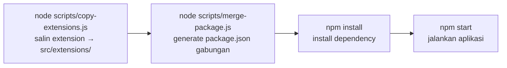

# DEVELOPER-GUIDE — Dari Nol Sampai Bisa Berkontribusi

> **Bahasa Indonesia | [English](./en/DEVELOPER-GUIDE.md)**

> **Dokumen ini menjawab:** "Bagaimana cara kerjanya di praktik?"
> Untuk memahami desain sistem, baca [ARCHITECTURE.md](./ARCHITECTURE.md).
> Untuk aturan yang tidak boleh dilanggar, baca [CONTRACT.md](./CONTRACT.md).

**Audiens:** developer yang paham JavaScript dasar + `async/await`, tetapi **belum pernah** memakai Express, NATS, atau WebSocket. Semua konsep baru dijelaskan dari nol; fondasi JavaScript tidak diulang.

**Cara memakai panduan ini:** kerjakan berurutan. Setiap tutorial diakhiri **Latihan** dan **Checklist**. Jangan lompat ke Tutorial D+ sebelum Setup & Test berhasil.

---

## Daftar Isi

1. [Prasyarat & Konsep Dasar Kilat](#1-prasyarat--konsep-dasar-kilat)
2. [Setup & Jalankan dari Nol](#2-setup--jalankan-dari-nol)
3. [Menjalankan Test](#3-menjalankan-test)
4. [Tutorial A — Membuat Module Baru](#4-tutorial-a--membuat-module-baru)
5. [Tutorial B — Menambah Route, Service, Repository](#5-tutorial-b--menambah-route-service-repository)
6. [Tutorial C — Membuat Extension](#6-tutorial-c--membuat-extension)
7. [Tutorial D — WebSocket](#7-tutorial-d--websocket)
8. [Tutorial E — NATS](#8-tutorial-e--nats)
9. [Tutorial F — Scheduled Task](#9-tutorial-f--scheduled-task)
10. [Debugging & Troubleshooting](#10-debugging--troubleshooting)
11. [Cheat Sheet & Daftar Latihan](#11-cheat-sheet--daftar-latihan)

---

## 1. Prasyarat & Konsep Dasar Kilat

### Yang harus sudah terpasang

| Tool | Versi | Cek dengan | Kenapa |
| --- | --- | --- | --- |
| Node.js | ≥ 20.11 (disarankan 22) | `node -v` | Menjalankan aplikasi; butuh `import.meta.dirname` |
| npm | bawaan Node | `npm -v` | Install dependency |
| PostgreSQL | 14+ | `psql --version` | Database utama — **wajib**, aplikasi menolak start tanpa ini |
| Docker (opsional) | terbaru | `docker -v` | Cara termudah menjalankan PostgreSQL & NATS lokal |

### Empat konsep yang akan sering muncul

**1. ESM (`import`/`export`)**
Repo ini memakai ES Modules. Artinya: `package.json` punya `"type": "module"`, dan semua file memakai `import ... from "..."` — **bukan** `require()`. Jika Anda menulis `require`, aplikasi error.

```js
import fs from "node:fs";                 // modul bawaan Node
import express from "express";            // modul npm
import config from "./src/libs/config.js";// file lokal — WAJIB pakai ekstensi .js

export default function hello() {}        // ekspor utama satu file
export function helper() {}               // ekspor bernama (bisa banyak)
```

**2. `async/await`**
Sebagian besar operasi di sini (query database, publish NATS, baca file) bersifat asynchronous. Pola:

```js
async function getUser(id) {
  const rows = await repo.findById(id);   // tunggu hasilnya
  return rows;
}
```

**3. HTTP server & middleware (Express)**
Express menerima HTTP request dan memanggil **handler** sesuai rute. **Middleware** adalah fungsi yang dijalankan sebelum handler — cocok untuk auth, validasi, logging. Urutan pemanggilan: middleware global → middleware route → handler.

**4. Event bus & WebSocket (NATS / WS)**
- **NATS** = papan pengumuman antar-module: satu module menaruh pesan di *subject* (`user.created`), module lain mendengarkan subject itu. Pengirim dan penerima tidak saling kenal.
- **WebSocket (WS)** = koneksi dua arah yang tetap terbuka; server bisa mendorong data ke browser kapan saja. Berbeda dengan HTTP yang selalu "tanya-jawab".

Empat-empatnya dipakai lewat kantong dependency bersama bernama `deps` (dijelaskan di [ARCHITECTURE.md §6.1](./ARCHITECTURE.md#61-deps--live-bindings)).

---

## 2. Setup & Jalankan dari Nol

### 2.1 Siapkan dua repo berdampingan

Sistem terdiri dari dua repo. Posisikan bersebelahan:

```text
modular-api-workspace/
├── express-modular-sample/            # base-api (aplikasi inti)
└── express-modular-extension-sample/  # extension-api (kustomisasi)
```

`copy-extensions.js` mencari folder extension dengan dua nama: `extension-api` (asli) atau `express-modular-extension-sample` (workspace ini). Bisa juga diarahkan manual: `EXT_DIR=/path/ke/extension npm run poc:copy`.

### 2.2 (Disarankan) PostgreSQL & NATS lokal via Docker

`PG_HOST` di file `.env` contoh mengarah ke server POC remote — jangan dipakai untuk latihan yang mengubah data. Jalankan yang lokal saja:

```bash
# PostgreSQL
docker run --name pg-poc -e POSTGRES_PASSWORD=pass -e POSTGRES_DB=arsi_system_db -p 5432:5432 -d postgres:16

# NATS + JetStream (opsional — tanpa ini aplikasi tetap jalan dalam degraded mode)
docker run --name nats-poc -p 4222:4222 -d nats:latest -js
```

Buat tabel minimal (sekali saja):

```bash
docker exec -i pg-poc psql -U postgres -d arsi_system_db <<'SQL'
CREATE TABLE IF NOT EXISTS app_user (id SERIAL PRIMARY KEY, name TEXT NOT NULL);
CREATE TABLE IF NOT EXISTS app_role (id SERIAL PRIMARY KEY, name TEXT NOT NULL);
CREATE TABLE IF NOT EXISTS app_user_role (user_id INT REFERENCES app_user(id), role_id INT REFERENCES app_role(id));
CREATE TABLE IF NOT EXISTS products (id SERIAL PRIMARY KEY, name TEXT NOT NULL);
CREATE TABLE IF NOT EXISTS policies (id SERIAL PRIMARY KEY, title TEXT NOT NULL);
CREATE TABLE IF NOT EXISTS audit_logs (id TEXT PRIMARY KEY, user_id INT, action TEXT);
INSERT INTO app_user (name) VALUES ('Alice') ON CONFLICT DO NOTHING;
INSERT INTO app_role (name) VALUES ('admin') ON CONFLICT DO NOTHING;
INSERT INTO products (name) VALUES ('Product 1') ON CONFLICT DO NOTHING;
INSERT INTO policies (title) VALUES ('Policy 1') ON CONFLICT DO NOTHING;
SQL
```

### 2.3 Sesuaikan `.env` (base-api)

File `.env` di `express-modular-sample/` menentukan koneksi. Untuk lokal:

```dotenv
PORT=3000
NODE_ENV=development
LOG_LEVEL=debug

# PostgreSQL — WAJIB
PG_HOST=localhost
PG_PORT=5432
PG_USER=postgres
PG_PASSWORD=pass
PG_DATABASE=arsi_system_db

# NATS — opsional (degraded mode tanpa ini)
NATS_SERVERS=nats://localhost:4222
NATS_REQUIRED=false
```

Variabel lain (`WS_HEARTBEAT_MS`, `SCHEDULER_ENABLED`, dst.) bisa dilihat di `.env` atau `src/libs/config.js`.

### 2.4 Perintah bootstrap



```bash
cd express-modular-sample

node scripts/copy-extensions.js   # 1. salin isi extension-api/src → src/extensions/
node scripts/merge-package.js     # 2. generate package.json dari package.base.json + extension
npm install                       # 3. install dependency (pertama kali / setelah dependency berubah)
npm start                         # 4. jalankan
```

> `package.json` adalah file generated dan tidak di-track. Pada clone baru, jalankan dua perintah `node scripts/...` di atas (atau `./run-poc.sh`) sebelum `npm install`/`npm test`.

Contoh output yang benar:

```text
✓ Copied extensions from ../express-modular-extension-sample/src to src/extensions
[merge-package] Strategy: extension-wins
[merge-package] Changes: +1 added, =0 same, !0 conflicts (0 MAJOR)
[merge-package] ✓ package.json generated
```

### 2.5 Verifikasi aplikasi berjalan

Saat start, aplikasi mencetak **route table**. Inilah peta seluruh endpoint hasil komposisi module + extension:

```text
  Module: audit-user  →  /audit
      [audit] GET     /audit/logs
      [audit] POST    /audit/log
      [audit] POST    /audit/notify
      [audit] GET     /audit/users/:id
  ✓ 4 routes mounted

  Module: product-management  →  /products
      [policy] GET     /products/policies
      [policy] POST    /products/policies [new]
      [policy] GET     /products/policies/:id
      [product] GET     /products
      [product] GET     /products/:id [overwrite]
  ✓ 5 routes mounted

  Module: user-management  →  /users
      [role] GET     /users/roles
      [user] GET     /users
      [user] GET     /users/:id [overwrite]
      [user] DELETE  /users/:id [new]
  ✓ 4 routes mounted
```

`[overwrite]` / `[new]` menunjukkan peran extension. Uji dua endpoint:

```bash
curl -s http://localhost:3000/health
# {"ok":true,"degraded":false,"checks":{"pg":true,"nats":true,"ws":true},"uptimeSec":3}

curl -s http://localhost:3000/users/1
# {"id":1,"name":"Alice","roles":["admin"],"enriched":true}
```

Response `/users/1` punya `enriched` dan `roles` — itu bukti extension ikut bekerja (menimpa handler base dengan versi yang diperkaya).

### Latihan

1. Ubah `PORT=3001` di `.env`, restart, akses `/health` di port baru.
2. Matikan container NATS (`docker stop nats-poc`), restart aplikasi, amati log *degraded mode* dan nilai `checks.nats` pada `/health`. Hidupkan lagi, tunggu log *background retry succeeded*.
3. Hapus folder `src/extensions/`, jalankan `npm start` — berapa module yang terdeteksi? Lalu pulihkan dengan `npm run poc:copy`.

### Checklist

- [ ] `node -v` menunjukkan versi ≥ 20.11
- [ ] PostgreSQL lokal jalan dan tabel minimal sudah dibuat
- [ ] `npm run poc:copy` mencetak `✓ Copied extensions...`
- [ ] `npm run merge:ext` mencetak `✓ package.json generated`
- [ ] `npm start` mencetak route table lengkap dengan label `[overwrite]`/`[new]`
- [ ] `curl /health` mengembalikan `"ok":true`
- [ ] `curl /users/1` mengembalikan body ber-`enriched`

---

## 3. Menjalankan Test

### 3.1 Perintah

```bash
npm run poc:copy   # WAJIB dulu — test butuh src/extensions/
npm test           # node --test "test/**/*.test.js"
```

Output yang diharapkan (ringkas):

```text
ok 1 - repositories/services use $1 placeholders and extract rows
...
ok 40 - rate limit rejects requests over the limit and resets after the window
# tests 40
# pass 40
# fail 0
```

### 3.2 Struktur test

```text
test/
├── helpers/
│   ├── fakes.js          # fake logger/db/nats/ws/scheduler + installFakeDeps()
│   └── buildTestApp.js   # rakit app lengkap (discover + init + mount) + withServer()
├── repositories.test.js  # SQL & ekstraksi rows
└── routes.test.js        # endpoint HTTP (base + extension)
```

Test **tidak menyentuh** PostgreSQL/NATS asli. Semuanya memakai *fake*: objek tiruan dengan perilaku minimal yang mencatat pemanggilan, sehingga test cepat dan bisa jalan di mana saja.

### 3.3 Tiga pola penting

**a. `installFakeDeps()` — mengisi kantong deps dengan tiruan**

```js
import { installFakeDeps, fakeDb } from "./helpers/fakes.js";

test("...", async () => {
  const fake = fakeDb();
  installFakeDeps({ db: fake });        // override hanya db
  // sekarang import { db } dari libs/deps.js akan melihat `fake`
  // fake.calls berisi semua query yang dipanggil kode
});
```

**b. Route file dijalankan di proses terpisah — deps di-populate per test**

Karena itu, test bisa saling tidak mengganggu walau memakai modul yang sama.

**c. `buildTestApp()` + `withServer()` — uji lewat HTTP sungguhan**

```js
import { buildTestApp, withServer } from "./helpers/buildTestApp.js";

test("GET /users", async () => {
  const { app } = await buildTestApp();          // app dengan fakes
  await withServer(app, async (base) => {        // listen di port acak
    const res = await fetch(`${base}/users`);    // fetch bawaan Node
    assert.equal(res.status, 200);
    console.log(await res.json());
  });
});
```

### Latihan

1. Tambahkan test baru: `GET /products/:id` harus mengembalikan `source: "extension"`.
2. Jalankan hanya satu file test: `node --test test/routes.test.js`.
3. Ubah `fakeDb()` agar `FROM products` mengembalikan 2 baris — test mana yang gagal? Mengapa?

### Checklist

- [ ] `npm test` hijau (40/40)
- [ ] Paham beda `installFakeDeps` (unit-level) vs `buildTestApp` (HTTP-level)
- [ ] Tahu kenapa `poc:copy` harus dijalankan sebelum test

---

## 4. Tutorial A — Membuat Module Baru

Kita akan membuat module **inventory-management** dengan dua endpoint:

| Method | Path | Fungsi |
| --- | --- | --- |
| GET | `/inventory` | daftar item |
| GET | `/inventory/:id` | satu item |

### Langkah 1 — Buat struktur folder

```text
src/modules/inventory-management/
├── index.js
├── routes/
│   └── route.inventory.js
├── services/
│   └── service.inventory.js
└── repositories/
    └── repo.inventory.js
```

### Langkah 2 — `index.js` (metadata module)

```js
// src/modules/inventory-management/index.js
export default {
  prefix: "/inventory",

  async init(deps) {
    const { logger } = deps;
    logger.info("[inventory-management] init");
  },
};
```

Ini wajib: `discover()` hanya mengenali folder sebagai module kalau ada `index.js` dengan `export default`. Tanpa `init` pun boleh (`export default { prefix: "/inventory" }`).

### Langkah 3 — Repository (akses database)

```js
// src/modules/inventory-management/repositories/repo.inventory.js
import { db } from "../../../libs/deps.js";

export default {
  async findById(id) {
    const { rows } = await db.query(
      "SELECT * FROM inventory_items WHERE id = $1",
      [id],
    );
    return rows[0] ?? null;
  },
  async findAll() {
    const { rows } = await db.query("SELECT * FROM inventory_items");
    return rows;
  },
};
```

Perhatikan: (1) `import` deps dipakai **di dalam function**; (2) placeholder SQL selalu `$1` (gaya PostgreSQL), bukan `?`; (3) hasil query diambil dari `rows`.

### Langkah 4 — Service (logika bisnis)

```js
// src/modules/inventory-management/services/service.inventory.js
import repo from "../repositories/repo.inventory.js";
import { logger } from "../../../libs/deps.js";

async function get(id) {
  logger.debug("service.inventory.get", id);
  const item = await repo.findById(Number(id));
  if (!item) throw new Error("Inventory item not found");
  return item;
}

async function list() {
  return repo.findAll();
}

export default { get, list };
```

### Langkah 5 — Route (HTTP)

```js
// src/modules/inventory-management/routes/route.inventory.js
import service from "../services/service.inventory.js";

export default function registerInventory(r) {
  r.get("/", async (req, res) => {
    res.json(await service.list());
  });

  r.get("/:id", async (req, res) => {
    try {
      res.json(await service.get(req.params.id));
    } catch (e) {
      res.status(404).json({ error: e.message });
    }
  });
}
```

### Langkah 6 — Verifikasi

Test cepat tanpa database (direkomendasikan):

```js
// test/inventory.test.js
import test from "node:test";
import assert from "node:assert/strict";
import { buildTestApp, withServer } from "./helpers/buildTestApp.js";

test("GET /inventory/:id mengembalikan item", async () => {
  const { app } = await buildTestApp();

  await withServer(app, async (base) => {
    const res = await fetch(`${base}/inventory/1`);
    assert.equal(res.status, 404);   // fake db belum mengenal tabel baru — sementara
  });
});
```

Jalankan:

```bash
npm run poc:copy && npm test
```

404 di sini **normal**: fake db belum tahu tabel `inventory_items`, sehingga service melempar "not found". Sekarang tambahkan pola SQL di `test/helpers/fakes.js`, di dalam `fakeDb()`:

```js
if (/FROM inventory_items\b/i.test(sql)) {
  return { rows: [{ id: 1, name: "Kabel HDMI" }], rowCount: 1 };
}
```

Lalu ubah assertion menjadi jalur sukses:

```js
const res = await fetch(`${base}/inventory/1`);
assert.equal(res.status, 200);
assert.deepEqual(await res.json(), { id: 1, name: "Kabel HDMI" });
```

Verifikasi penuh dengan database asli: restart `npm start` dan perhatikan route table menampilkan module baru:

```text
  Module: inventory-management  →  /inventory
    [inventory]
      GET     /inventory
      GET     /inventory/:id
  ✓ 2 routes mounted
```

Jangan lupa tabelnya:

```sql
CREATE TABLE IF NOT EXISTS inventory_items (id SERIAL PRIMARY KEY, name TEXT NOT NULL);
INSERT INTO inventory_items (name) VALUES ('Kabel HDMI');
```

### Latihan

1. Tambahkan `POST /inventory` yang memakai `db.insert("inventory_items", req.body)`.
2. Tambahkan logging dengan `logger.info` di service.
3. Tambahkan endpoint `GET /inventory/summary` yang mengembalikan `{ total: n }` — **letakkan sebelum `/:id` di file yang sama** dan jelaskan kenapa urutannya penting ([CONTRACT §3](./CONTRACT.md#3-route-merge-contract)).

### Checklist

- [ ] Route table saat start menampilkan `/inventory`
- [ ] `GET /inventory` dan `GET /inventory/:id` merespons benar
- [ ] Test baru hijau
- [ ] Anda bisa menjelaskan kenapa `db.query` dipakai di dalam function, bukan di top-level

---

## 5. Tutorial B — Menambah Route, Service, Repository

Sekarang kita ubah module **product-management** yang sudah ada: tambah endpoint ringkasan jumlah produk.

| Method | Path | Hasil |
| --- | --- | --- |
| GET | `/products/summary` | `{ total: 3 }` |

### Langkah 1 — Service dulu (logika)

```js
// src/modules/product-management/services/service.product.js
import productRepo from "../repositories/repo.product.js";
import { db } from "../../../libs/deps.js";

async function get(id) { /* ... yang sudah ada ... */ }
async function list() { /* ... yang sudah ada ... */ }

async function summary() {
  const { rows } = await db.query("SELECT COUNT(*)::int AS total FROM products");
  return { total: rows[0].total };
}

export default { get, list, summary };
```

### Langkah 2 — Route (perhatikan urutannya!)

```js
// src/modules/product-management/routes/route.product.js
import productService from "../services/service.product.js";

export default function registerProduct(r) {
  r.get("/", async (req, res) => {
    res.json(await productService.list());
  });

  r.get("/summary", async (req, res) => {          // ✅ static — SEBELUM /:id
    res.json(await productService.summary());
  });

  r.get("/:id", async (req, res) => {              // parameter — SETELAH static
    try {
      res.json(await productService.get(req.params.id));
    } catch (e) {
      res.status(404).json({ error: e.message });
    }
  });
}
```

> Jika `/summary` diletakkan setelah `/:id`, request `GET /products/summary` akan dianggap `GET /products/:id` dengan `id = "summary"` → 404 `Product not found`. Aturan lengkap: [CONTRACT §3](./CONTRACT.md#3-route-merge-contract).

### Langkah 3 — Update fake db & test

Tambahkan di `test/helpers/fakes.js`:

```js
if (/COUNT\(\*\)/i.test(sql)) return { rows: [{ total: 3 }], rowCount: 1 };
```

(asalkan ditempatkan **sebelum** pola `FROM products` yang mengembalikan baris biasa.)

Tambahkan test:

```js
test("GET /products/summary", async () => {
  const { app } = await buildTestApp();
  await withServer(app, async (base) => {
    const res = await fetch(`${base}/products/summary`);
    assert.equal(res.status, 200);
    assert.deepEqual(await res.json(), { total: 3 });
  });
});
```

### Langkah 4 — Verifikasi dengan server asli

```bash
npm start
curl -s http://localhost:3000/products/summary
# {"total":1}
```

### Kapan service dan repository dipisah?

| Situasi | Pola |
| --- | --- |
| Logika kecil, satu query | Query langsung di service (seperti `service.policy.js`) |
| >1 query / dipakai ulang | Pisahkan repository (`repo.*.js`) — seperti `user-management` |

Tidak ada aturan mutlak; yang penting konsisten dalam satu module.

### Latihan

1. Tambahkan `GET /products/search?name=...` (parameter query) — jangan lupa urutan static.
2. Tambahkan `POST /policies` di module inti (insert via `db.insert`) — perhatikan: extension sample juga mendaftarkan `POST /products/policies`; apa yang terjadi pada hasil merge? Jelaskan.
3. Ubah `summary()` agar juga mengembalikan `updatedAt` (timestamp sekarang).

### Checklist

- [ ] `/products/summary` mengembalikan angka benar pada server asli
- [ ] Test baru hijau dan fake db diperbarui
- [ ] Anda bisa menjelaskan kenapa urutan route static penting

---

## 6. Tutorial C — Membuat Extension

Semua pekerjaan di bab ini dilakukan di repo **extension-api**, bukan base-api. Ingat: `src/extensions/` di base adalah hasil copy.

### 6.1 Overwrite — menimpa route base (contoh nyata: `GET /users/:id`)

```js
// express-modular-extension-sample/src/user-management/route.user.extend.js
import userServiceBase from "../../modules/user-management/services/service.user.js";
import helperService from "./service.helper.js";
import mw from "./middleware.extend.js";

export default function extendUser(r) {
  r.get("/:id", mw.auth, mw.requestLogger, mw.rateLimit, async (req, res) => {
    try {
      const base = await userServiceBase.getUser(req.params.id);
      res.json(await helperService.enrich(base));
    } catch (e) {
      res.status(404).json({ error: e.message });
    }
  });
}
```

Yang terjadi setelah merge: handler base untuk `GET /users/:id` **dibuang seluruhnya**, diganti rantai middleware extension + handler baru. Ini disebut mode `overwrite` (default). Bukti di route table: `GET /users/:id [overwrite]`.

### 6.2 Prepend — menambah middleware sebelum handler base

Buat extension baru untuk module product-management:

```js
// extension-api/src/product-management/route.product.extend.js
import mw from "../user-management/middleware.extend.js";

export default function extendProduct(r) {
  // ... route yang sudah ada ...

  r.get("/", { prepend: [mw.rateLimit] });   // handler base dipertahankan
}
```

Hasil setelah merge: `rateLimit → handlerBase`. Handler base tetap dipakai; kita hanya menyisipkan middleware.

Setelah menulis, jalankan:

```bash
cd ../express-modular-sample
npm run poc:copy && npm start
```

Route table akan menampilkan `GET /products [prepend]`.

### 6.3 Merge middleware — sisipkan di antara middleware base dan handler

```js
r.get("/products-anda", { mergeMiddleware: true }, mw.requestLogger, handler);
```

Aturan hasilnya: `middlewareBase → middlewareExtension → handler`. Catatan penting: **handler terakhir tetap dianggap terminal**. Kalau route base hanya berisi satu handler (seperti semua route di sample ini), `mergeMiddleware` akan berakhir seperti overwrite kecuali Anda menyertakan handler terminal di extension. Untuk sample ini, `prepend` lebih praktis. Detail: [CONTRACT §3](./CONTRACT.md#3-route-merge-contract).

Jika extension hanya berisi middleware dan handler base harus tetap dipakai, tambahkan `keepBaseHandler: true`:

```js
r.get("/", { mergeMiddleware: true, keepBaseHandler: true }, mw.requestLogger);
// hasil: handlerBase tetap menjadi terminal
```

### 6.4 Route baru — endpoint yang tidak ada di base

```js
// mode "new" — contoh nyata:
r.delete("/:id", mw.auth, mw.requireRole("admin"), async (req, res) => {
  res.json({ deleted: req.params.id, by: req.user.name });
});
```

Route table menandainya `[new]`.

### 6.5 Extension-only module

Folder module yang **hanya ada di extension** (tidak ada pasangannya di `src/modules/`). Contoh: `audit-user`.

```text
extension-api/src/audit-user/
├── index.js            # export default { prefix, init } — seperti module biasa
├── routes/route.audit.js
├── services/service.audit.js
└── repositories/repo.audit.js
```

Bedanya dengan module biasa hanya satu: **jangan** buat `init.extend.js` di sini (`index.js` sudah mengurus init). Di base, module ini muncul sebagai `Module: audit-user → /audit` tanpa label merge apa pun.

### 6.6 Middleware extension

`middleware.extend.js` berisi middleware siap pakai yang bisa dipakai lintas module:

```js
import mw from "../user-management/middleware.extend.js";

r.get("/contoh", mw.auth, mw.requireRole("admin"), handler);
```

| Middleware | Efek |
| --- | --- |
| `mw.auth` | Set `req.user` (POC: selalu user admin) |
| `mw.requireRole("admin")` | 403 jika role tidak cocok |
| `mw.requestLogger` | Log durasi & status |
| `mw.rateLimit` | 429 setelah 100 req/menit per IP |

### Latihan

1. Buat endpoint baru `GET /products/reports/low-stock` di extension (path dua segmen agar tidak bentrok dengan `/:id`).
2. Ubah `GET /products/:id` agar menambahkan `fetchedAt` (timestamp) di response.
3. Buat extension-only module `client-notes` dengan satu endpoint `GET /client-notes`.

### Checklist

- [ ] `npm run poc:copy` dijalankan setelah setiap perubahan extension
- [ ] Route table menampilkan label mode (`[overwrite]`/`[prepend]`/`[new]`) sesuai harapan
- [ ] Anda bisa menjelaskan beda `index.js` dan `init.extend.js`

---

## 7. Tutorial D — WebSocket

WebSocket cocok untuk data push real-time (notifikasi, monitoring). Satu server WS dipakai bersama semua module; tiap module mendaftarkan **channel** (path) miliknya.

### Langkah 1 — Daftarkan channel di `init`

```js
// src/modules/inventory-management/index.js
export default {
  prefix: "/inventory",

  async init(deps) {
    const { ws, logger } = deps;

    ws.register(
      "/ws/inventory",                      // unik! konvensi /ws/<module>
      (socket, req) => {
        logger.info("[inventory] ws connected");

        socket.send(
          JSON.stringify({ type: "welcome", module: "inventory-management" }),
        );

        socket.on("message", (raw) => {
          try {
            const msg = JSON.parse(raw.toString());
            socket.send(JSON.stringify({ echo: msg }));
          } catch {
            socket.send(JSON.stringify({ error: "invalid json" }));
          }
        });
      },
      { owner: "inventory-management" },
    );
  },
};
```

Aturan lengkap: [CONTRACT §5](./CONTRACT.md#5-websocket-contract).

### Langkah 2 — Broadcast dari mana saja

```js
// dari route handler:
const sent = ws.broadcast("/ws/inventory", { type: "stock-updated", id: 1 });
```

`ws.broadcast` mengembalikan jumlah client yang menerima.

### Langkah 3 — Uji dari terminal

Dengan server berjalan (`npm start`), jalankan skrip kecil ini (pakai package `ws` yang sudah ter-install di base):

```bash
node --input-type=module -e "
import WebSocket from 'ws';
const client = new WebSocket('ws://localhost:3000/ws/inventory');
client.on('message', (raw) => { console.log('diterima:', raw.toString()); client.close(); });
client.on('error', (err) => { console.error('gagal:', err.message); process.exit(1); });
"
```

Output: `diterima: {"type":"welcome","module":"inventory-management"}`.

Path yang tidak terdaftar (mis. `/ws/ngawur`) akan ditolak dengan 404 saat upgrade.

### Latihan

1. Kirim pesan JSON dari client dan pastikan di-echo server.
2. Tambahkan broadcast ke `/ws/inventory` setiap kali `GET /inventory` dipanggil.
3. Daftarkan channel kedua `/ws/inventory-admin` — apa yang terjadi kalau Anda mendaftarkan `/ws/inventory` dua kali?

### Checklist

- [ ] Client WS berhasil connect dan menerima welcome
- [ ] Echo bekerja
- [ ] Anda paham kenapa path WS harus unik (dan apa akibatnya jika duplikat)

---

## 8. Tutorial E — NATS

NATS dipakai untuk event antar-module. Tanpa server NATS, aplikasi tetap jalan dalam *degraded mode*.

### Langkah 1 — Jalankan NATS lokal (opsional tapi disarankan)

```bash
docker run --name nats-poc -p 4222:4222 -d nats:latest -js
```

### Langkah 2 — Publish (mengirim event)

```js
// dari route handler — aman dipanggil kapan saja:
nats.publish("inventory.item-created", { id: 1, name: "Kabel HDMI" });
// return true/false — false berarti NATS sedang tidak tersedia (sudah dicatat log)

// untuk event yang tidak boleh hilang, pakai JetStream:
await nats.jsPublish("inventory.item-created", { id: 1 });
// return objek acknowledgment atau null jika gagal
```

### Langkah 3 — Subscribe cara yang benar (reconnect-safe)

Ini pola **wajib** — jangan subscribe langsung di `init` tanpa wrapper:

```js
async init(deps) {
  const { nats, logger } = deps;

  function setup() {
    if (!nats.isAvailable()) return;              // 1. cek ketersediaan

    const sub = nats.subscribeJson("user.created"); // 2. subscribe
    (async () => {
      for await (const { data } of sub) {         // 3. loop pesan
        logger.info("[inventory] user.created", data);
      }
    })().catch((err) =>
      logger.debug("[inventory] sub ended", { error: err.message }),
    );
  }

  nats.onConnected(setup);                        // 4. dipanggil lagi saat reconnect
  if (nats.isAvailable()) setup();                // 5. kasus sudah terhubung sejak awal
}
```

Kenapa begini? Saat koneksi putus permanen lalu background retry berhasil, semua subscription lama mati. `onConnected` dipanggil setiap koneksi sukses, sehingga `setup()` membuat subscription baru. Detail: [CONTRACT §6](./CONTRACT.md#6-nats-contract).

### Langkah 4 — JetStream consumer (pesan yang tidak boleh hilang)

```js
const consumer = await nats.consume("USERS", "inventory-worker");  // stream, durable name unik
const messages = await consumer.consume();

for await (const m of messages) {
  try {
    const data = JSON.parse(nats.get().sc.decode(m.data));
    // ... proses ...
    m.ack();     // sukses → acknowledged
  } catch (err) {
    m.nak();     // gagal → akan dikirim ulang
  }
}
```

### Langkah 5 — Uji end-to-end

1. Pastikan NATS lokal jalan dan aplikasi sudah restart (log `[nats] connected`).
2. Publish event dari endpoint lain, mis. `POST /audit/log` (itu melakukan `jsPublish("audit.logged", ...)`).
3. Amati log module yang men-subscribe.

### Latihan

1. Tambahkan subscribe `user.deleted` di module inventory (log saja).
2. Matikan NATS saat aplikasi berjalan (`docker stop nats-poc`), amati log, lalu hidupkan lagi — amati `[nats] background retry succeeded` dan subscription kembali aktif.
3. Jelaskan kenapa `nats.publish` tidak perlu `try/catch` tetapi `nats.get()` perlu pengecekan `isAvailable()`.

### Checklist

- [ ] Pesan publish diterima subscriber yang sesuai
- [ ] Anda bisa mendemokan reconnect: subscription kembali aktif tanpa restart aplikasi
- [ ] Tidak ada subscription di top-level module

---

## 9. Tutorial F — Scheduled Task

### Langkah 1 — Daftarkan task di `init`

```js
async init(deps) {
  const { scheduler, logger } = deps;

  scheduler.register({
    name: "inventory:stock-snapshot",   // namespace <module>:<task> — wajib unik
    schedule: "*/5 * * * *",            // tiap 5 menit (5 field cron)
    owner: "inventory-management",
    handler: async () => {
      const { db } = deps;              // boleh juga import dari deps.js
      const { rows } = await db.query("SELECT COUNT(*)::int AS total FROM inventory_items");
      logger.info("[inventory] stock snapshot", { total: rows[0].total });
    },
  });
}
```

### Format cron singkat

```text
┌───── menit (0-59)
│ ┌─── jam (0-23)
│ │ ┌─ tanggal (1-31)
│ │ │ ┌ bulan (1-12)
│ │ │ │ ┌ hari (0-6, Minggu=0)
* * * * *
```

| Contoh | Arti |
| --- | --- |
| `*/5 * * * *` | setiap 5 menit |
| `0 * * * *` | setiap jam tepat |
| `0 7 * * 1-5` | hari kerja jam 07:00 |
| `30 2 * * *` | tiap hari 02:30 UTC |

### Langkah 2 — Verifikasi

Restart aplikasi dan amati log scheduler:

```text
[scheduler] started {"name":"inventory:stock-snapshot","schedule":"*/5 * * * *",...}
```

Untuk latihan cepat, ubah schedule ke `* * * * *` (tiap menit) dan tunggu log `[scheduler] task done`.

### Opsi lain

| Opsi | Fungsi |
| --- | --- |
| `runOnInit: true` | Jalankan sekali saat `startAll()` setelah `listen` |
| `timezone: "Asia/Jakarta"` | Override timezone (default UTC) |

Task yang masih berjalan saat tick berikutnya tiba otomatis di-skip (dengan warning) — desain handler harus mendukung ini.

### Latihan

1. Buat task `inventory:cleanup` yang berjalan tiap jam dan mencatat log.
2. Daftarkan task dengan `runOnInit: true` — kapan handler dieksekusi relatif terhadap listen?
3. Coba daftarkan dua task dengan nama sama — apa yang terjadi? Di mana errornya muncul?

### Checklist

- [ ] Task muncul di log saat `[scheduler] started`
- [ ] Handler dieksekusi sesuai jadwal
- [ ] Nama task ber-namespace dan unik

---

## 10. Debugging & Troubleshooting

### 10.1 Alat debugging dasar

| Alat | Cara pakai | Kegunaan |
| --- | --- | --- |
| Access log | otomatis tiap request | `reqId`, method, path, status, durasi |
| Request ID | `curl -H "x-request-id: tes-123" ...` | Menghubungkan log request ↔ kejadian |
| `/health` | `curl localhost:3000/health` | Cek PG/NATS/WS sekilas |
| `LOG_LEVEL=debug` | di `.env` | Query SQL, detail NATS, WS |
| Route table | tercetak saat start | Endpoint yang benar-benar terpasang |
| `npm test` | — | Regresi cepat tanpa database |

### 10.2 Gejala umum dan solusinya

| Gejala | Penyebab umum | Solusi |
| --- | --- | --- |
| Boot berhenti dengan `postgres unreachable` | PostgreSQL mati / `.env` salah | Nyalakan PG, cek `PG_HOST/PG_PORT` |
| Boot berhenti dengan `Missing required env: PG_...` | `.env` belum diisi | Salin `.env.example` ke `.env` dan isi nilainya |
| Log `[nats] initial connect failed — degraded mode` | NATS tidak jalan | Normal untuk POC — jalankan NATS bila butuh fitur event |
| `EADDRINUSE :::3000` | Port sudah dipakai proses lain | Matikan proses lama atau ganti `PORT` |
| `WS path already registered: /ws/x` | Dua module memakai path WS sama | Ganti path dengan namespace module |
| `scheduler.register: task already registered` | Nama task duplikat | Beri namespace `<module>:<task>` |
| Request 404 padahal route ada di kode | Nama file bukan `route.<group>.js`; module tidak terdeteksi | Cek route table; perbaiki nama file |
| `/users/roles` malah kena `/:id` | Urutan route static vs parameter | Lihat [CONTRACT §3](./CONTRACT.md#3-route-merge-contract) |
| `TypeError: Cannot read properties of null (reading 'query')` | Mengakses deps di top-level module | Pindahkan ke dalam function |
| Test gagal: `src/extensions/ belum di-populate` | lupa copy extension | `npm run poc:copy` |
| `Cannot find module 'uuid'` | Dependency extension belum dimerge | `npm run merge:ext && npm install` |
| `require is not defined` / `module is not defined` | Menulis kode CommonJS | Ubah ke `import`/`export` |
| `ERR_MODULE_NOT_FOUND` di extension | Path import salah (jumlah `../` keliru) | Dari `src/extensions/<mod>/`: libs = `../../libs/deps.js`; dari subfolder = `../../../libs/deps.js` |
| Perubahan extension tidak berefek | Lupa copy / server belum restart | `npm run poc:copy` lalu restart |
| Shutdown lama (>10 detik) | Ada WS client terbuka / task panjang | Cek log urutan shutdown; tutup client saat testing |

### 10.3 Membaca log dengan `reqId`

```text
2026-10-15T08:33:33.179Z [base-api] info: http {"reqId":"171234-abc123","method":"GET","path":"/users/1","status":200,"durationMs":12}
2026-10-15T08:33:33.180Z [base-api] debug: service.user.getUser {"id":"1"}
```

Semua log request membawa `reqId`. Kalau ada error, cari `reqId` yang sama di baris log lain:

```text
... error: unhandled request error {"reqId":"171234-abc123","error":"db down",...}
```

### Latihan

1. Sengaja tulis `db.getPool()` di top-level sebuah module, amati error yang muncul saat boot, lalu perbaiki.
2. Sengaja daftarkan route WS `/ws/users` di module inventory — baca pesan error lengkapnya.
3. Matikan PostgreSQL saat aplikasi berjalan, panggil `GET /users`, amati status 500 dan log error dengan `reqId`, lalu nyalakan PG lagi dan panggil ulang.

### Checklist

- [ ] Anda bisa menemukan log sebuah request lewat `reqId`
- [ ] Anda tahu beda 404 (tidak ada/gagal cocok) vs 500 (error di server)
- [ ] Anda tahu ke mana harus melihat lebih dulu ketika ada gejala umum di tabel 10.2

---

## 11. Cheat Sheet & Daftar Latihan

### Perintah

> Fresh clone: `package.json` belum ada. Jalankan `node scripts/copy-extensions.js && node scripts/merge-package.js` dulu, baru perintah npm di bawah.

```bash
npm run poc:copy     # salin extension → src/extensions/
npm run merge:ext    # generate package.json gabungan
npm run merge:ext:dry# preview merge tanpa mengubah file
npm install          # install dependency
npm start            # jalankan server
npm test             # jalankan test (butuh poc:copy)
```

### "Mau melakukan X" → baca di mana

| Keinginan | Buka |
| --- | --- |
| Membuat module/endpoint baru | [Tutorial A](./DEVELOPER-GUIDE.md#4-tutorial-a--membuat-module-baru) |
| Menambah route ke module yang ada | [Tutorial B](./DEVELOPER-GUIDE.md#5-tutorial-b--menambah-route-service-repository) |
| Menimpa/menambah perilaku tanpa mengubah base | [Tutorial C](./DEVELOPER-GUIDE.md#6-tutorial-c--membuat-extension) |
| Push data real-time ke client | [Tutorial D](./DEVELOPER-GUIDE.md#7-tutorial-d--websocket) |
| Kirim/terima event antar-module | [Tutorial E](./DEVELOPER-GUIDE.md#8-tutorial-e--nats) |
| Task berkala (cron) | [Tutorial F](./DEVELOPER-GUIDE.md#9-tutorial-f--scheduled-task) |
| Memahami alur boot / route merge / shutdown | [ARCHITECTURE.md](./ARCHITECTURE.md) |
| Aturan & invarian (jangan dilanggar) | [CONTRACT.md](./CONTRACT.md) |
| Query database, transaksi, insert | [CONTRACT.md §4](./CONTRACT.md#4-deps-contract) & [ARCHITECTURE.md §6.2](./ARCHITECTURE.md#62-postgresql-srclibsdbjs) |
| Aturan penulisan test | [CONTRACT.md §9](./CONTRACT.md#9-test-contract) |
| Bentuk response & error | [CONTRACT.md §10](./CONTRACT.md#10-error-contract) |

### Daftar latihan mandiri (rekap)

| Bab | Latihan |
| --- | --- |
| 2 (Setup) | 1. Ganti port · 2. Degraded mode NATS · 3. Hapus `src/extensions/` |
| 3 (Test) | 1. Test `source: extension` · 2. Jalankan satu file test · 3. Ubah fake db |
| 4 (Module baru) | 1. `POST /inventory` · 2. Logging service · 3. `/summary` + urutan route |
| 5 (Tambah route) | 1. `/products/search` · 2. `POST /policies` di base vs extension · 3. `updatedAt` |
| 6 (Extension) | 1. `/products/reports/low-stock` · 2. `fetchedAt` · 3. `client-notes` |
| 7 (WebSocket) | 1. Echo · 2. Broadcast dari route · 3. Path duplikat |
| 8 (NATS) | 1. Subscribe `user.deleted` · 2. Simulasi reconnect · 3. `publish` vs `get` |
| 9 (Scheduler) | 1. `inventory:cleanup` · 2. `runOnInit` · 3. Nama duplikat |
| 10 (Debugging) | 1. Deps top-level · 2. Path WS duplikat · 3. PG mati di tengah jalan |

Selesai semua bab + latihan? Anda sudah siap berkontribusi tanpa menyentuh kode inti. Langkah berikutnya yang disarankan: baca [CONTRACT.md](./CONTRACT.md) sekali lagi dengan pengalaman praktik Anda — semua aturannya akan terasa masuk akal.

---

**Dokumen terkait:**
- [ARCHITECTURE.md](./ARCHITECTURE.md) — cara kerja sistem
- [CONTRACT.md](./CONTRACT.md) — aturan & invarian
