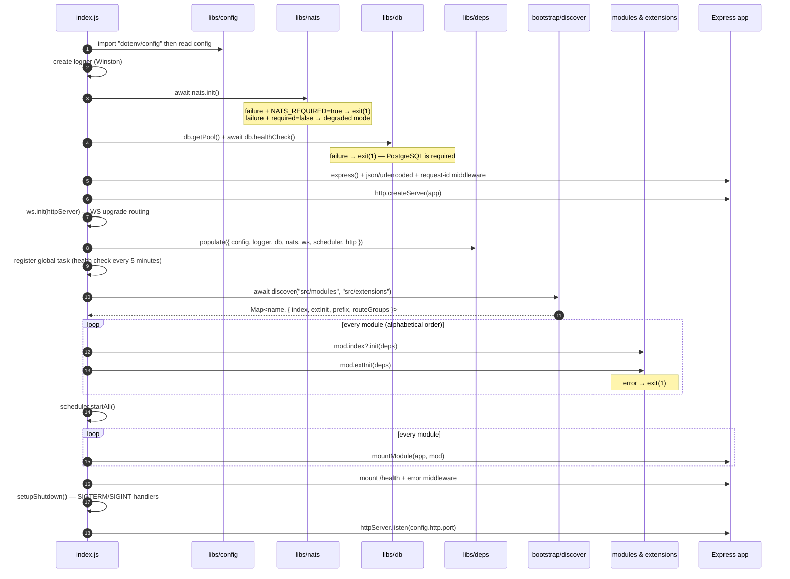
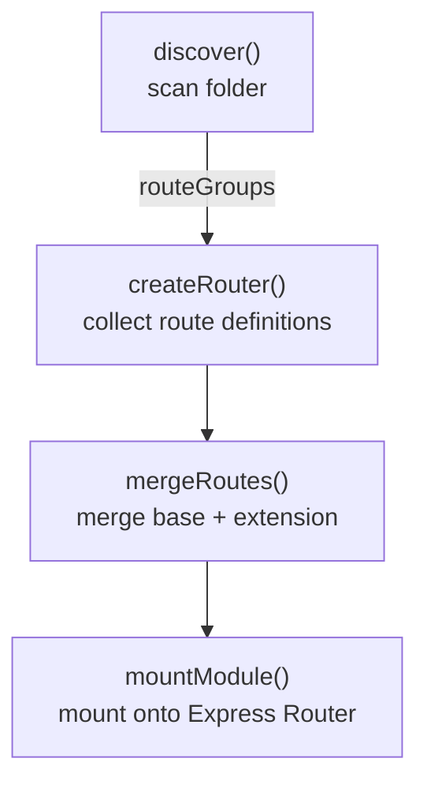
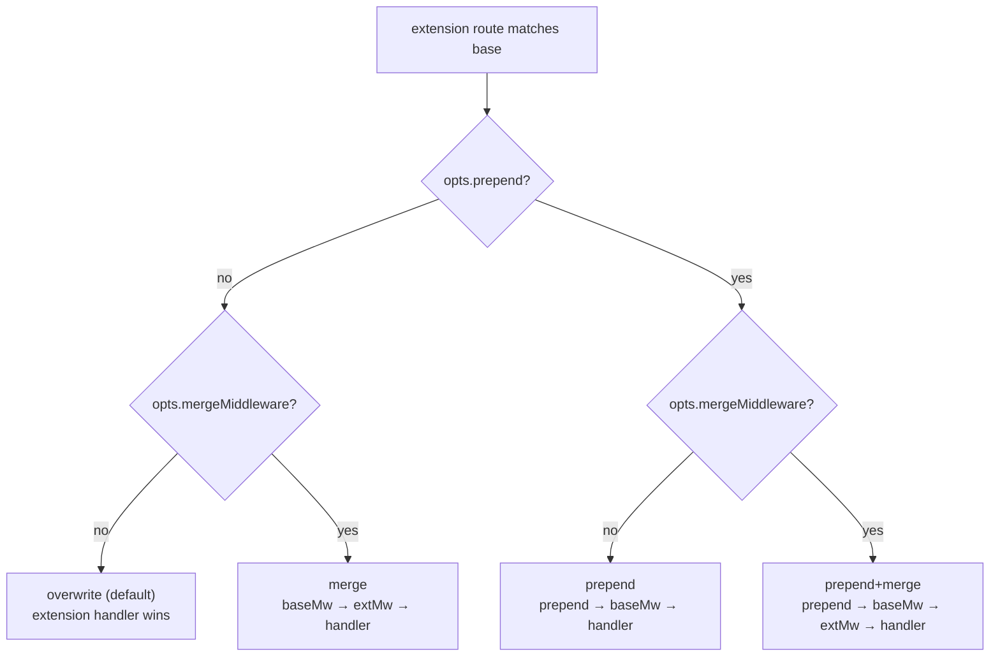
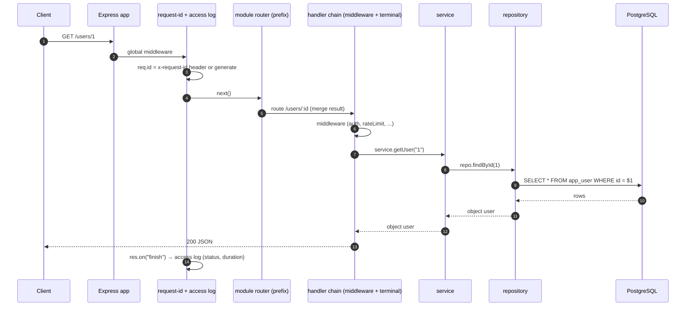
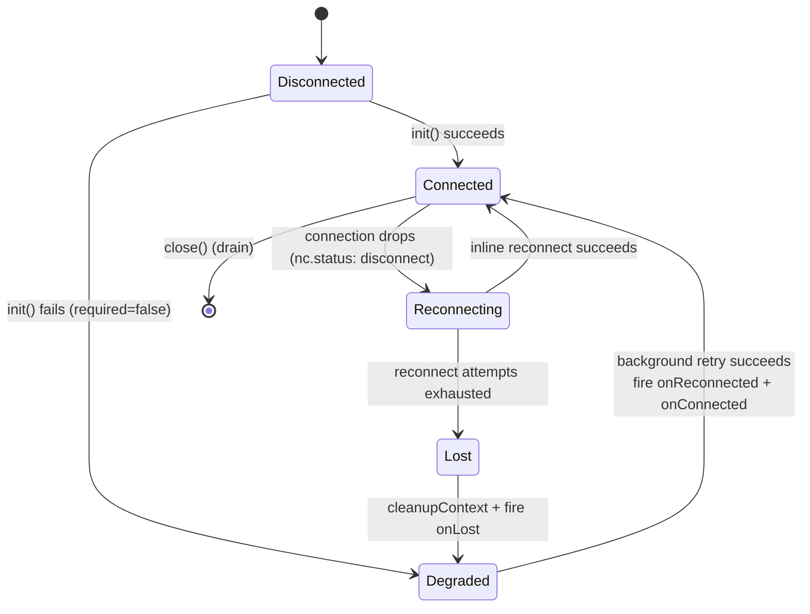
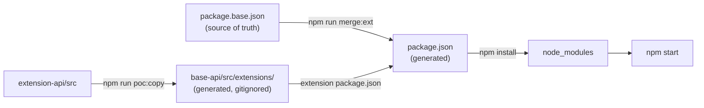
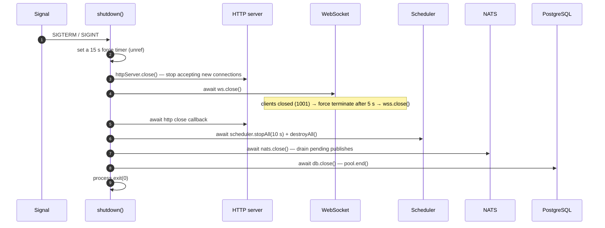

# ARCHITECTURE — base-api & extension-api

> **Bahasa Indonesia: [ARCHITECTURE.md](../ARCHITECTURE.md) | English**

> **This document answers:** "How does this system work, and why was it designed that way?"
> For the rules that must not be violated, read [CONTRACT.md](./CONTRACT.md).
> For hands-on steps to write code, read [DEVELOPER-GUIDE.md](./DEVELOPER-GUIDE.md).

**Audience:** developers who understand basic JavaScript + `async/await`, but have never used Express, NATS, or WebSocket.

**Code version documented:** branch `feature/express5-esm` — ESM, Express 5, the term **module** (formerly "feature").

---

## Table of Contents

1. [What are base-api & extension-api](#1-what-are-base-api--extension-api)
2. [Concept Map](#2-concept-map)
3. [Bootstrap Lifecycle](#3-bootstrap-lifecycle)
4. [Composition Pipeline](#4-composition-pipeline)
5. [Request Lifecycle](#5-request-lifecycle)
6. [Shared Infrastructure Clients](#6-shared-infrastructure-clients)
7. [Build Pipeline](#7-build-pipeline)
8. [Graceful Shutdown](#8-graceful-shutdown)
9. [Current Design Limitations (POC)](#9-current-design-limitations-poc)

---

## 1. What are base-api & extension-api

Imagine a SaaS product used by many clients. 90% of the code is the same for every client, but each client asks for small differences: extra endpoints, stricter validation, a different response format.

The common approach (one fork per client) causes: bug fixes must be copied into every fork, and the forks slowly diverge into different products.

**base-api** is a single core application. **extension-api** is a separate repo containing *only client customizations*. At build time, the extension contents are **copied** into the base (`src/extensions/`), then the base composes the core modules + extensions into one running application.

```text
┌────────────────────┐      ┌────────────────────┐
│  base-api          │      │  extension-api     │
│  (core product)    │      │  (customizations)  │
│  src/modules/      │      │  src/              │
│    user-management │◄─────│    user-management │  ← override / addition
│    product-manag.  │ copy │    product-manag.  │
└────────────────────┘      │    audit-user      │  ← new module (extension-only)
        │                   └────────────────────┘
        ▼
  one running Express application
```

Benefits:
- **The core code stays one.** Bug fixes only in base-api.
- **Isolated customizations.** Client differences are collected in one extension repo.
- **A clear contract.** Extensions may only interact through the rules documented in [CONTRACT.md](./CONTRACT.md).

> ⚠️ This is not a runtime plugin system. Composition happens at **build** time (files copied + merged), not while the application is running.

---

## 2. Concept Map

Four terms that will keep coming up:

| Term | Meaning | Example |
| --- | --- | --- |
| **Module** | One complete piece of functionality: HTTP routes, service, repository, and an optional init hook | `user-management`, `product-management` |
| **Extension** | Customization code attached to a module (overriding/adding routes, middleware, init) or creating a new client-specific module | `route.user.extend.js`, `audit-user` |
| **Shared libs** (`src/libs/`) | Shared infrastructure: config, logger, database, NATS, WebSocket, scheduler, and the route composition engine | `src/libs/db.js` |
| **deps** | Shared dependency bag injected into every module during bootstrap | `{ config, logger, db, nats, ws, scheduler, http }` |

### base-api folder structure

```text
express-modular-sample/
├── index.js                     # entry point: the whole bootstrap
├── package.base.json            # source of truth for dependencies & scripts
├── package.json                 # GENERATED — do not edit manually
├── scripts/
│   ├── merge-package.js         # merge package.base.json + extension
│   └── copy-extensions.js       # copy extension-api/src → src/extensions/
├── src/
│   ├── libs/                    # infra + composition engine
│   │   ├── config.js            # read environment variables
│   │   ├── logger.js            # Winston
│   │   ├── deps.js              # dependency bag (live bindings)
│   │   ├── db.js                # PostgreSQL pool + query/tx/insert
│   │   ├── nats.js              # NATS + JetStream + reconnection
│   │   ├── ws.js                # WebSocket server + channel registry
│   │   ├── scheduler.js         # cron tasks
│   │   ├── routeCollector.js    # fake "router" that collects route definitions
│   │   ├── mergeRoutes.js       # merge engine base + extension
│   │   ├── mountModule.js       # mount the merge result onto Express
│   │   └── bootstrap/discover.js# scan folder → list of modules
│   ├── modules/                 # core modules (product)
│   │   ├── user-management/
│   │   └── product-management/
│   └── extensions/              # GENERATED (gitignored) — copy result
│       ├── user-management/     # *.extend.js + init.extend.js files
│       ├── product-management/
│       └── audit-user/          # extension-only module
└── test/                        # node:test
```

### extension-api folder structure

```text
express-modular-extension-sample/
├── package.json                 # only declares extra dependencies (uuid)
└── src/
    ├── user-management/         # customization of the user-management module
    │   ├── route.user.extend.js
    │   ├── middleware.extend.js
    │   ├── service.helper.js
    │   └── init.extend.js
    ├── product-management/
    │   ├── route.product.extend.js
    │   └── route.policy.extend.js
    └── audit-user/              # extension-only module (new client-owned module)
        ├── index.js
        ├── routes/
        ├── services/
        └── repositories/
```

**Note:** in an extension, route files are named `route.<group>.extend.js` (not `route.<group>.js`). It is this file name that tells `discover()` that the file is an *extension*, not a base route.

---

## 3. Bootstrap Lifecycle

The entire startup sequence lives in `index.js` inside the `main()` function. The order **must not be shuffled** — several steps depend on earlier steps.



Key points beginners often ask about:

1. **`import "dotenv/config"` must run first** so that `process.env` is already populated when `config.js` is evaluated. That is why it is written on the first line of `index.js`.
2. **NATS is optional, PostgreSQL is required.** If NATS is unavailable, the application still runs in *degraded mode* (NATS-based features are dead, the rest live). If PostgreSQL is unavailable, the application refuses to start.
3. **`populate(deps)` happens BEFORE `discover()`.** Modules are loaded dynamically by `discover()`; at that moment they read `deps`. Getting this order wrong is the classic cause of the `Cannot read properties of null` error.
4. **Module init order follows folder name (alphabetical)** — `audit-user` → `product-management` → `user-management`. Do not rely on this order for dependencies between modules.
5. **Routes are mounted last**, after all init hooks. So even if an init hook throws an error, the app exits immediately and never receives half-ready traffic.

---

## 4. Composition Pipeline

This is the heart of the system: how route files from modules and extensions become one Express router. It has four stages.



### 4.1 Discovery (`src/libs/bootstrap/discover.js`)

`discover()` scans two folders:

- `src/modules/<name>/routes/` — core routes
- `src/extensions/<name>/` and `src/extensions/<name>/routes/` — extension routes

The file name determines its role:

| File name | Role |
| --- | --- |
| `route.user.js` | Base route for the group named `user` |
| `route.user.extend.js` | Extension for the `user` group |
| `index.js` | Module metadata: `{ prefix, init }` |
| `init.extend.js` | Init hook specific to the extension |

The end result is a `Map` containing each module's descriptor:

```js
{
  name: "user-management",
  index: { prefix: "/users", init(deps) { ... } },  // from index.js (module or extension-only)
  extInit: async function initUserExt(deps) { ... }, // from init.extend.js (optional)
  prefix: "/users",                                  // from index.prefix, fallback "/<name>"
  routeGroups: [ { groupName: "user", baseRegister, extendRegister } ]
}
```

### 4.2 Route Collector (`src/libs/routeCollector.js`)

`createRouter()` is not an Express Router. It is only a collector object: every call to `r.get(path, ...handlers)` is recorded as `{ method, path, handlers, opts }` without being mounted onto Express right away. This is what makes it possible to *merge* routes before they become a real router.

### 4.3 Merge Engine (`src/libs/mergeRoutes.js`)

Base routes and extension routes are matched by the key `"<method> <path>"`. Four merge modes:



Rules to understand:

- **The last handler** in a route definition is treated as the *terminal handler* (the one that sends the response); the rest are treated as *middleware*.
- `prepend` inserts middleware **before** all base middleware.
- `mergeMiddleware: true` inserts extension middleware **after** base middleware (still before the handler).
- With no options → **overwrite**: the extension handler replaces the base handler entirely.
- An extension route with no match in the base → `_mode: "new"`.

Example from the sample repo (see the route table printed at startup):

```text
Module: user-management  →  /users
    [role]
      GET     /users/roles
    [user]
      GET     /users
      GET     /users/:id [overwrite]     ← route.user.extend.js overrides GET /users/:id
      DELETE  /users/:id [new]           ← new route from the extension
```

### 4.4 Mount (`src/libs/mountModule.js`)

The final stage: the merge result is mounted onto one `express.Router()` per module, then that router is `app.use(prefix, router)`-ed. Every mounted route is printed to the console so developers can immediately see which merge mode was applied.

> ⚠️ Because Express matches routes **in order** (first match), route order matters. Details and the rules are in [CONTRACT.md §3](./CONTRACT.md#3-route-merge-contract).

---

## 5. Request Lifecycle

Once the application is running, what happens when an HTTP request comes in?



The application layers:

| Layer | Responsibility | Example |
| --- | --- | --- |
| Route | Receive the HTTP request, call the service, send the response | `route.user.js` |
| Middleware | Auth, validation, rate limit, logging (may stop the request) | `middleware.extend.js` |
| Service | Business logic, rules, orchestration | `service.user.js` |
| Repository | Database access (SQL) | `repo.user.js` |

**Error handling:** Express 5 automatically forwards errors from `async` handlers to the global error middleware (even without `try/catch`, it will not hang). The error middleware logs and sends `500 { "error": "internal error" }`. Routes that have a "not found" scenario still handle it themselves and return `404 { "error": "User not found" }`.

---

## 6. Shared Infrastructure Clients

All modules access infrastructure through `deps` — not by creating their own connections. This keeps a single database pool, a single NATS connection, a single WebSocket server, and a single scheduler across the whole process.

### 6.1 deps — live bindings

`src/libs/deps.js` exports live bindings:

```js
export let db = null;          // ← initial value
export function populate(values) { /* fills in the bindings above */ }
```

Consumer modules write `import { db } from ".../libs/deps.js"` and then use `db.query(...)` **inside the function body**. Because the bindings are live, when `populate()` is called from `index.js`, every module automatically sees the latest values — with no need to `require` again or inject manually.

The complete rules are in [CONTRACT.md §4](./CONTRACT.md#4-deps-contract).

### 6.2 PostgreSQL (`src/libs/db.js`)

- `getPool()` — creates a `pg.Pool` the first time it is called (lazy), with max connections, idle timeout, and connection timeout from config.
- `query(sql, params)` — a `pool.query` wrapper with duration + rowCount logging; errors are re-thrown after being logged.
- `tx(fn)` — transaction: `BEGIN` → `fn(client)` → `COMMIT`, `ROLLBACK` on error, `client.release()` always.
- `insert(table, row)` — dynamic insert helper: columns are taken from the object keys, values are parameterized (`$1, $2, ...`), table/column names are validated with an identifier regex (preventing SQL injection through column names), and it returns the resulting row (`RETURNING *`).
- `healthCheck()` — `SELECT 1`, used during bootstrap and by the `/health` endpoint.

### 6.3 NATS + JetStream (`src/libs/nats.js`)

NATS is used for event communication between modules (`user.created`, etc.). This module has a fairly rich reconnection state machine:



Callbacks provided:

| Callback | When it is called | Purpose |
| --- | --- | --- |
| `onConnected(fn)` | Every time a connection succeeds (initial **and** after background retry) | (re-)subscribe |
| `onLost(fn)` | The connection is permanently lost after all retries are exhausted | log, metrics, mark degraded |
| `onReconnected(fn)` | Background retry succeeds | custom recovery |

**Why is the re-subscribe pattern important?** After a reconnect via background retry, the old subscriptions have died together with the old connection. That is why every module registers an idempotent `setup()` function with `onConnected` — the full pattern is in [CONTRACT.md §6](./CONTRACT.md#6-nats-contract) and the tutorial is in [DEVELOPER-GUIDE.md](./DEVELOPER-GUIDE.md).

Two publish modes:
- `publish(subject, payload)` — core NATS, fire-and-forget, returns `false` if unavailable.
- `jsPublish(subject, payload)` — JetStream, gets an acknowledgment, returns `null` on failure.

### 6.4 WebSocket (`src/libs/ws.js`)

A single `WebSocketServer` with `noServer: true`; routing is done manually based on the URL path at upgrade time:

- `register(path, handler, { owner })` — register a channel. **Throws if the path is already registered** (prevents clashes between modules).
- An upgrade request to an unknown path → `404` and the socket is destroyed.
- Heartbeat: every `WS_HEARTBEAT_MS` (default 30 s) the server sends a `ping`; a client that does not reply with `pong` is `terminate`-d.
- `broadcast(path, payload)` — sends to all clients on that channel (JSON.stringify is automatic).
- Maximum payload 1 MB (`WS_MAX_PAYLOAD`).

### 6.5 Scheduler (`src/libs/scheduler.js`)

A `node-cron` wrapper with safeguards:

- Unique task names; cron expression validation at registration.
- Anti-overlap guard: if a task is still running when the next tick arrives, that tick is skipped and logged.
- `stopAll({ waitMs })` — stops accepting new ticks and waits for in-flight tasks (for graceful shutdown).
- `runOnInit: true` — run once at startup (via `setImmediate`).

### 6.6 Logger (`src/libs/logger.js`)

Winston with two formats: colorized + concise for development, JSON for production. `logger.child({ module: "x" })` creates a child logger with extra metadata. Always use this logger, not `console.log`, in production code (except the route table in `mountModule.js`, which is intentionally visual output for developers).

---

## 7. Build Pipeline

Running the application is not just `npm install && npm start`. There is a composition step:



The full sequence (all available in `run-poc.sh`):

```bash
npm run poc:copy    # 1. copy extension-api/src → src/extensions/
npm run merge:ext   # 2. generate package.json from package.base.json + extension
npm install         # 3. install the combined dependencies
npm start           # 4. run
```

The contract details — why `package.json` is gitignored, how version conflicts are handled, what `MERGE_STRATEGY` means — are in [CONTRACT.md §8](./CONTRACT.md#8-package-contract).

---

## 8. Graceful Shutdown

On receiving `SIGTERM`/`SIGINT` (e.g. `Ctrl+C` or a new deploy), the application must stop without cutting off in-flight requests and without hanging. The sequence is orchestrated in `setupShutdown()` (`index.js`):



Two reasons this order matters:

1. **`ws.close()` must finish before `httpServer.close()` actually completes.** Connections that have been upgraded to WebSocket are not tracked as regular HTTP connections; if they are not closed, the HTTP server `close` callback can hang until the 15-second force timer fires and the process exits with exit code 1.
2. **The scheduler is closed before NATS and DB**, because running tasks still use both.

`shutdown()` is idempotent (the `shuttingDown` flag), so back-to-back `SIGTERM` and `SIGINT` do not trigger a duplicate shutdown process.

---

## 9. Current Design Limitations (POC)

This document is honest about its limitations — don't let beginners assume everything is production-grade:

| Limitation | Detail | Location |
| --- | --- | --- |
| Hardcoded auth | The `auth` middleware always sets the user `Catherine/admin`; no JWT/session verification yet | `extension-api/src/user-management/middleware.extend.js` |
| In-memory rate limit | A Map with no periodic cleanup — it grows with the number of IPs | the same file |
| `API_KEY` not used yet | Present in config and `.env`, not checked anywhere | `src/libs/config.js` |
| Fallback credentials in config | `config.pg` has hardcoded default host/user/password for POC convenience | `src/libs/config.js` |
| Build-time composition | Extensions are not runtime plugins; adding an extension means re-running `poc:copy` + restart | `scripts/copy-extensions.js` |
| Fail-fast boot | A single extension error during `init` fails the entire application (`process.exit(1)`) | `index.js` |
| WebSocket without auth | Upgrades are accepted for all registered paths | `src/libs/ws.js` |
| No CORS/helmet | No standard HTTP hardening yet | `index.js` |

Hardening plans are outside the scope of this document; for now, **do not use the POC configuration for production data**.

---

**Related documents:**
- [CONTRACT.md](./CONTRACT.md) — rules & invariants that must not be violated
- [DEVELOPER-GUIDE.md](./DEVELOPER-GUIDE.md) — hands-on tutorials for beginners
