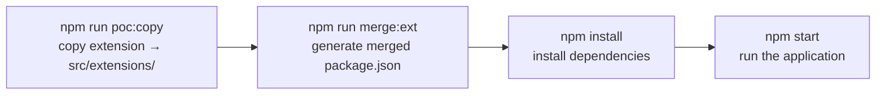

# DEVELOPER-GUIDE — From Zero to Contributing

> **Bahasa Indonesia: [DEVELOPER-GUIDE.md](../DEVELOPER-GUIDE.md) | English**

> **This document answers:** "How does it work in practice?"
> To understand the system design, read [ARCHITECTURE.md](./ARCHITECTURE.md).
> For the rules that must not be broken, read [CONTRACT.md](./CONTRACT.md).

**Audience:** developers who understand basic JavaScript + `async/await` but have **never** used Express, NATS, or WebSocket. Every new concept is explained from scratch; JavaScript fundamentals are not repeated.

**How to use this guide:** work through it in order. Every tutorial ends with **Exercises** and a **Checklist**. Don't jump to Tutorial D+ before Setup & Test succeed.

---

## Table of Contents

1. [Prerequisites & Quick Concepts](#1-prerequisites--quick-concepts)
2. [Setup & Run from Scratch](#2-setup--run-from-scratch)
3. [Running Tests](#3-running-tests)
4. [Tutorial A — Creating a New Module](#4-tutorial-a--creating-a-new-module)
5. [Tutorial B — Adding a Route, Service, Repository](#5-tutorial-b--adding-a-route-service-repository)
6. [Tutorial C — Creating an Extension](#6-tutorial-c--creating-an-extension)
7. [Tutorial D — WebSocket](#7-tutorial-d--websocket)
8. [Tutorial E — NATS](#8-tutorial-e--nats)
9. [Tutorial F — Scheduled Task](#9-tutorial-f--scheduled-task)
10. [Debugging & Troubleshooting](#10-debugging--troubleshooting)
11. [Cheat Sheet & Exercise Index](#11-cheat-sheet--exercise-index)

---

## 1. Prerequisites & Quick Concepts

### What must already be installed

| Tool | Version | Check with | Why |
| --- | --- | --- | --- |
| Node.js | ≥ 20.11 (22 recommended) | `node -v` | Runs the application; requires `import.meta.dirname` |
| npm | bundled with Node | `npm -v` | Installs dependencies |
| PostgreSQL | 14+ | `psql --version` | Main database — **required**, the application refuses to start without it |
| Docker (optional) | latest | `docker -v` | Easiest way to run PostgreSQL & NATS locally |

### Four concepts that will come up often

**1. ESM (`import`/`export`)**
This repo uses ES Modules. That means: `package.json` has `"type": "module"`, and all files use `import ... from "..."` — **not** `require()`. If you write `require`, the application errors.

```js
import fs from "node:fs";                 // built-in Node module
import express from "express";            // npm module
import config from "./src/libs/config.js";// local file — MUST use the .js extension

export default function hello() {}        // a file's main export
export function helper() {}               // named export (can be many)
```

**2. `async/await`**
Most operations here (database queries, NATS publishes, reading files) are asynchronous. The pattern:

```js
async function getUser(id) {
  const rows = await repo.findById(id);   // wait for the result
  return rows;
}
```

**3. HTTP server & middleware (Express)**
Express receives HTTP requests and calls the **handler** matching the route. **Middleware** is a function that runs before the handler — useful for auth, validation, logging. Call order: global middleware → route middleware → handler.

**4. Event bus & WebSocket (NATS / WS)**
- **NATS** = a message board between modules: one module posts a message on a *subject* (`user.created`), another module listens to that subject. Sender and receiver don't know each other.
- **WebSocket (WS)** = a two-way connection that stays open; the server can push data to the browser at any time. Unlike HTTP, which is always "question and answer".

All four are used through a shared dependency bag called `deps` (explained in [ARCHITECTURE.md §6.1](./ARCHITECTURE.md#61-deps--live-bindings)).

---

## 2. Setup & Run from Scratch

### 2.1 Prepare two repos side by side

The system consists of two repos. Place them side by side:

```text
modular-api-workspace/
├── express-modular-sample/            # base-api (core application)
└── express-modular-extension-sample/  # extension-api (customization)
```

`copy-extensions.js` looks for the extension folder under two names: `extension-api` (original) or `express-modular-extension-sample` (this workspace). You can also point it manually: `EXT_DIR=/path/to/extension npm run poc:copy`.

### 2.2 (Recommended) Local PostgreSQL & NATS via Docker

`PG_HOST` in the sample `.env` file points to a remote POC server — don't use it for exercises that modify data. Run things locally instead:

```bash
# PostgreSQL
docker run --name pg-poc -e POSTGRES_PASSWORD=pass -e POSTGRES_DB=arsi_system_db -p 5432:5432 -d postgres:16

# NATS + JetStream (optional — without it the app still runs in degraded mode)
docker run --name nats-poc -p 4222:4222 -d nats:latest -js
```

Create the minimal tables (once only):

```bash
docker exec -i pg-poc psql -U postgres -d arsi_system_db <<'SQL'
CREATE TABLE IF NOT EXISTS app_user (id SERIAL PRIMARY KEY, name TEXT NOT NULL);
CREATE TABLE IF NOT EXISTS app_role (id SERIAL PRIMARY KEY, name TEXT NOT NULL);
CREATE TABLE IF NOT EXISTS app_user_role (user_id INT REFERENCES app_user(id), role_id INT REFERENCES app_role(id));
CREATE TABLE IF NOT EXISTS products (id SERIAL PRIMARY KEY, name TEXT NOT NULL);
CREATE TABLE IF NOT EXISTS policies (id SERIAL PRIMARY KEY, title TEXT NOT NULL);
CREATE TABLE IF NOT EXISTS audit_logs (id TEXT PRIMARY KEY, user_id INT, action TEXT);
INSERT INTO app_user (name) VALUES ('Alice') ON CONFLICT DO NOTHING;
INSERT INTO app_role (name) VALUES ('admin') ON CONFLICT DO NOTHING;
INSERT INTO products (name) VALUES ('Product 1') ON CONFLICT DO NOTHING;
INSERT INTO policies (title) VALUES ('Policy 1') ON CONFLICT DO NOTHING;
SQL
```

### 2.3 Adjust `.env` (base-api)

The `.env` file in `express-modular-sample/` defines the connections. For local use:

```dotenv
PORT=3000
NODE_ENV=development
LOG_LEVEL=debug

# PostgreSQL — REQUIRED
PG_HOST=localhost
PG_PORT=5432
PG_USER=postgres
PG_PASSWORD=pass
PG_DATABASE=arsi_system_db

# NATS — optional (degraded mode without it)
NATS_SERVERS=nats://localhost:4222
NATS_REQUIRED=false
```

Other variables (`WS_HEARTBEAT_MS`, `SCHEDULER_ENABLED`, etc.) can be found in `.env` or `src/libs/config.js`.

### 2.4 The four core commands



```bash
cd express-modular-sample

npm run poc:copy     # 1. copy extension-api/src contents → src/extensions/
npm run merge:ext    # 2. generate package.json from package.base.json + extension
npm install          # 3. install dependencies (first time / after dependencies change)
npm start            # 4. run
```

Example of correct output:

```text
✓ Copied extensions from ../express-modular-extension-sample/src to src/extensions
[merge-package] Strategy: extension-wins
[merge-package] Changes: +1 added, =0 same, !0 conflicts (0 MAJOR)
[merge-package] ✓ package.json generated
```

### 2.5 Verify the application is running

On startup, the application prints the **route table**. It is the map of every endpoint produced by composing modules + extensions:

```text
  Module: audit-user  →  /audit
    [audit]
      GET     /audit/logs
      GET     /audit/users/:id
      POST    /audit/log
      POST    /audit/notify
  ✓ 4 routes mounted

  Module: product-management  →  /products
    [policy]
      GET     /products/policies
      GET     /products/policies/:id
      POST    /products/policies [new]
    [product]
      GET     /products
      GET     /products/:id [overwrite]
  ✓ 5 routes mounted

  Module: user-management  →  /users
    [role]
      GET     /users/roles
    [user]
      GET     /users
      GET     /users/:id [overwrite]
      DELETE  /users/:id [new]
  ✓ 4 routes mounted
```

`[overwrite]` / `[new]` show the extension's role. Test two endpoints:

```bash
curl -s http://localhost:3000/health
# {"ok":true,"uptimeSec":3,"checks":{"pg":true,"nats":true,"ws":true}}

curl -s http://localhost:3000/users/1
# {"id":1,"name":"Alice","roles":["admin"],"enriched":true}
```

The `/users/1` response has `enriched` and `roles` — proof that the extension is working too (it overwrites the base handler with an enriched version).

### Exercises

1. Change `PORT=3001` in `.env`, restart, access `/health` on the new port.
2. Stop the NATS container (`docker stop nats-poc`), restart the application, watch for the *degraded mode* log and the `checks.nats` value on `/health`. Start it again and wait for the *background retry succeeded* log.
3. Delete the `src/extensions/` folder, run `npm start` — how many modules are detected? Then restore it with `npm run poc:copy`.

### Checklist

- [ ] `node -v` shows a version ≥ 20.11
- [ ] Local PostgreSQL is running and the minimal tables are created
- [ ] `npm run poc:copy` prints `✓ Copied extensions...`
- [ ] `npm run merge:ext` prints `✓ package.json generated`
- [ ] `npm start` prints the full route table with `[overwrite]`/`[new]` labels
- [ ] `curl /health` returns `"ok":true`
- [ ] `curl /users/1` returns a body containing `enriched`

---

## 3. Running Tests

### 3.1 Commands

```bash
npm run poc:copy   # MUST come first — tests need src/extensions/
npm test           # node --test "test/**/*.test.js"
```

Expected output (abridged):

```text
ok 1 - repositories/services use $1 placeholders and extract rows
ok 2 - buildInsertSQL generates parameterized INSERT with RETURNING
ok 3 - base + extension routes respond correctly
ok 4 - async db errors become JSON 500 instead of hanging
# tests 4
# pass 4
# fail 0
```

### 3.2 Test structure

```text
test/
├── helpers/
│   ├── fakes.js          # fake logger/db/nats/ws/scheduler + installFakeDeps()
│   └── buildTestApp.js   # build the full app (discover + init + mount) + withServer()
├── repositories.test.js  # SQL & row extraction
└── routes.test.js        # HTTP endpoints (base + extension)
```

Tests **do not touch** real PostgreSQL/NATS. Everything uses *fakes*: fake objects with minimal behavior that record calls, so tests are fast and can run anywhere.

### 3.3 Three important patterns

**a. `installFakeDeps()` — fill the deps bag with fakes**

```js
import { installFakeDeps, fakeDb } from "./helpers/fakes.js";

test("...", async () => {
  const fake = fakeDb();
  installFakeDeps({ db: fake });        // override only db
  // now import { db } from libs/deps.js will see `fake`
  // fake.calls contains every query the code called
});
```

**b. Route files run in a separate process — deps are populated per test**

Because of that, tests don't interfere with each other even when they use the same module.

**c. `buildTestApp()` + `withServer()` — test through real HTTP**

```js
import { buildTestApp, withServer } from "./helpers/buildTestApp.js";

test("GET /users", async () => {
  const { app } = await buildTestApp();          // app with fakes
  await withServer(app, async (base) => {        // listen on a random port
    const res = await fetch(`${base}/users`);    // Node's built-in fetch
    assert.equal(res.status, 200);
    console.log(await res.json());
  });
});
```

### Exercises

1. Add a new test: `GET /products/:id` must return `source: "extension"`.
2. Run only one test file: `node --test test/routes.test.js`.
3. Change `fakeDb()` so `FROM products` returns 2 rows — which test fails? Why?

### Checklist

- [ ] `npm test` is green (4/4)
- [ ] You understand the difference between `installFakeDeps` (unit-level) and `buildTestApp` (HTTP-level)
- [ ] You know why `poc:copy` must be run before tests

---

## 4. Tutorial A — Creating a New Module

We will create an **inventory-management** module with two endpoints:

| Method | Path | Purpose |
| --- | --- | --- |
| GET | `/inventory` | list of items |
| GET | `/inventory/:id` | a single item |

### Step 1 — Create the folder structure

```text
src/modules/inventory-management/
├── index.js
├── routes/
│   └── route.inventory.js
├── services/
│   └── service.inventory.js
└── repositories/
    └── repo.inventory.js
```

### Step 2 — `index.js` (module metadata)

```js
// src/modules/inventory-management/index.js
export default {
  prefix: "/inventory",

  async init(deps) {
    const { logger } = deps;
    logger.info("[inventory-management] init");
  },
};
```

This is required: `discover()` only recognizes a folder as a module if there is an `index.js` with `export default`. Omitting `init` is fine too (`export default { prefix: "/inventory" }`).

### Step 3 — Repository (database access)

```js
// src/modules/inventory-management/repositories/repo.inventory.js
import { db } from "../../../libs/deps.js";

export default {
  async findById(id) {
    const { rows } = await db.query(
      "SELECT * FROM inventory_items WHERE id = $1",
      [id],
    );
    return rows[0] ?? null;
  },
  async findAll() {
    const { rows } = await db.query("SELECT * FROM inventory_items");
    return rows;
  },
};
```

Note: (1) the deps `import` is used **inside the function**; (2) SQL placeholders are always `$1` (PostgreSQL style), not `?`; (3) query results are taken from `rows`.

### Step 4 — Service (business logic)

```js
// src/modules/inventory-management/services/service.inventory.js
import repo from "../repositories/repo.inventory.js";
import { logger } from "../../../libs/deps.js";

async function get(id) {
  logger.debug("service.inventory.get", id);
  const item = await repo.findById(Number(id));
  if (!item) throw new Error("Inventory item not found");
  return item;
}

async function list() {
  return repo.findAll();
}

export default { get, list };
```

### Step 5 — Route (HTTP)

```js
// src/modules/inventory-management/routes/route.inventory.js
import service from "../services/service.inventory.js";

export default function registerInventory(r) {
  r.get("/", async (req, res) => {
    res.json(await service.list());
  });

  r.get("/:id", async (req, res) => {
    try {
      res.json(await service.get(req.params.id));
    } catch (e) {
      res.status(404).json({ error: e.message });
    }
  });
}
```

### Step 6 — Verify

Quick test without a database (recommended):

```js
// test/inventory.test.js
import test from "node:test";
import assert from "node:assert/strict";
import { buildTestApp, withServer } from "./helpers/buildTestApp.js";

test("GET /inventory/:id returns an item", async () => {
  const { app } = await buildTestApp();

  await withServer(app, async (base) => {
    const res = await fetch(`${base}/inventory/1`);
    assert.equal(res.status, 404);   // fake db doesn't know the new table yet — for now
  });
});
```

Run:

```bash
npm run poc:copy && npm test
```

The 404 here is **normal**: the fake db doesn't know the `inventory_items` table, so the service throws "not found". Now add an SQL pattern in `test/helpers/fakes.js`, inside `fakeDb()`:

```js
if (/FROM inventory_items\b/i.test(sql)) {
  return { rows: [{ id: 1, name: "HDMI Cable" }], rowCount: 1 };
}
```

Then change the assertion to the success path:

```js
const res = await fetch(`${base}/inventory/1`);
assert.equal(res.status, 200);
assert.deepEqual(await res.json(), { id: 1, name: "HDMI Cable" });
```

Full verification with a real database: restart `npm start` and notice the route table showing the new module:

```text
  Module: inventory-management  →  /inventory
    [inventory]
      GET     /inventory
      GET     /inventory/:id
  ✓ 2 routes mounted
```

Don't forget its table:

```sql
CREATE TABLE IF NOT EXISTS inventory_items (id SERIAL PRIMARY KEY, name TEXT NOT NULL);
INSERT INTO inventory_items (name) VALUES ('HDMI Cable');
```

### Exercises

1. Add `POST /inventory` that uses `db.insert("inventory_items", req.body)`.
2. Add logging with `logger.info` in the service.
3. Add an endpoint `GET /inventory/summary` that returns `{ total: n }` — **place it before `/:id` in the same file** and explain why the order matters ([CONTRACT §3](./CONTRACT.md#3-route-merge-contract)).

### Checklist

- [ ] The route table at startup shows `/inventory`
- [ ] `GET /inventory` and `GET /inventory/:id` respond correctly
- [ ] New test is green
- [ ] You can explain why `db.query` is used inside a function, not at the top level

---

## 5. Tutorial B — Adding a Route, Service, Repository

Now let's change the existing **product-management** module: add an endpoint that summarizes the product count.

| Method | Path | Result |
| --- | --- | --- |
| GET | `/products/summary` | `{ total: 3 }` |

### Step 1 — Service first (logic)

```js
// src/modules/product-management/services/service.product.js
import productRepo from "../repositories/repo.product.js";
import { db } from "../../../libs/deps.js";

async function get(id) { /* ... the existing one ... */ }
async function list() { /* ... the existing one ... */ }

async function summary() {
  const { rows } = await db.query("SELECT COUNT(*)::int AS total FROM products");
  return { total: rows[0].total };
}

export default { get, list, summary };
```

### Step 2 — Route (mind the order!)

```js
// src/modules/product-management/routes/route.product.js
import productService from "../services/service.product.js";

export default function registerProduct(r) {
  r.get("/", async (req, res) => {
    res.json(await productService.list());
  });

  r.get("/summary", async (req, res) => {          // ✅ static — BEFORE /:id
    res.json(await productService.summary());
  });

  r.get("/:id", async (req, res) => {              // parameter — AFTER static
    try {
      res.json(await productService.get(req.params.id));
    } catch (e) {
      res.status(404).json({ error: e.message });
    }
  });
}
```

> If `/summary` is placed after `/:id`, the request `GET /products/summary` will be treated as `GET /products/:id` with `id = "summary"` → 404 `Product not found`. Full rules: [CONTRACT §3](./CONTRACT.md#3-route-merge-contract).

### Step 3 — Update the fake db & test

Add to `test/helpers/fakes.js`:

```js
if (/COUNT\(\*\)/i.test(sql)) return { rows: [{ total: 3 }], rowCount: 1 };
```

(as long as it is placed **before** the `FROM products` pattern that returns regular rows.)

Add a test:

```js
test("GET /products/summary", async () => {
  const { app } = await buildTestApp();
  await withServer(app, async (base) => {
    const res = await fetch(`${base}/products/summary`);
    assert.equal(res.status, 200);
    assert.deepEqual(await res.json(), { total: 3 });
  });
});
```

### Step 4 — Verify with the real server

```bash
npm start
curl -s http://localhost:3000/products/summary
# {"total":1}
```

### When should service and repository be split?

| Situation | Pattern |
| --- | --- |
| Small logic, a single query | Query directly in the service (like `service.policy.js`) |
| >1 query / reused | Split out a repository (`repo.*.js`) — like `user-management` |

There is no absolute rule; what matters is staying consistent within a module.

### Exercises

1. Add `GET /products/search?name=...` (query parameter) — don't forget the static order.
2. Add `POST /policies` in the core module (insert via `db.insert`) — note: the sample extension also registers `POST /products/policies`; what happens to the merge result? Explain.
3. Change `summary()` so it also returns `updatedAt` (current timestamp).

### Checklist

- [ ] `/products/summary` returns the correct number on the real server
- [ ] New test is green and the fake db is updated
- [ ] You can explain why static route order matters

---

## 6. Tutorial C — Creating an Extension

All work in this chapter happens in the **extension-api** repo, not base-api. Remember: `src/extensions/` in the base is the result of a copy.

### 6.1 Overwrite — replace a base route (real example: `GET /users/:id`)

```js
// express-modular-extension-sample/src/user-management/route.user.extend.js
import userServiceBase from "../../modules/user-management/services/service.user.js";
import helperService from "./service.helper.js";
import mw from "./middleware.extend.js";

export default function extendUser(r) {
  r.get("/:id", mw.auth, mw.requestLogger, mw.rateLimit, async (req, res) => {
    try {
      const base = await userServiceBase.getUser(req.params.id);
      res.json(await helperService.enrich(base));
    } catch (e) {
      res.status(404).json({ error: e.message });
    }
  });
}
```

What happens after the merge: the base handler for `GET /users/:id` is **thrown away entirely** and replaced by the extension's middleware chain + new handler. This is called `overwrite` mode (the default). Proof in the route table: `GET /users/:id [overwrite]`.

### 6.2 Prepend — add middleware before the base handler

Create a new extension for the product-management module:

```js
// extension-api/src/product-management/route.product.extend.js
import mw from "../user-management/middleware.extend.js";

export default function extendProduct(r) {
  // ... the existing routes ...

  r.get("/", { prepend: [mw.rateLimit] });   // the base handler is kept
}
```

Result after the merge: `rateLimit → handlerBase`. The base handler is still used; we only insert middleware.

After writing, run:

```bash
cd ../express-modular-sample
npm run poc:copy && npm start
```

The route table will show `GET /products [prepend]`.

### 6.3 Merge middleware — insert between base middleware and handler

```js
r.get("/products-custom", { mergeMiddleware: true }, mw.requestLogger, handler);
```

The resulting rule: `middlewareBase → middlewareExtension → handler`. Important note: **the last handler is still treated as terminal**. If the base route contains only one handler (like every route in this sample), `mergeMiddleware` ends up behaving like overwrite unless you include a terminal handler in the extension. For this sample, `prepend` is more practical. Details: [CONTRACT §3](./CONTRACT.md#3-route-merge-contract).

### 6.4 New route — an endpoint that doesn't exist in the base

```js
// "new" mode — real example:
r.delete("/:id", mw.auth, mw.requireRole("admin"), async (req, res) => {
  res.json({ deleted: req.params.id, by: req.user.name });
});
```

The route table marks it `[new]`.

### 6.5 Extension-only module

A module folder that **exists only in the extension** (it has no counterpart in `src/modules/`). Example: `audit-user`.

```text
extension-api/src/audit-user/
├── index.js            # export default { prefix, init } — just like a regular module
├── routes/route.audit.js
├── services/service.audit.js
└── repositories/repo.audit.js
```

There is only one difference from a regular module: **don't** create `init.extend.js` here (`index.js` already handles init). In the base, this module appears as `Module: audit-user → /audit` without any merge label.

### 6.6 Extension middleware

`middleware.extend.js` contains ready-to-use middleware that can be used across modules:

```js
import mw from "../user-management/middleware.extend.js";

r.get("/example", mw.auth, mw.requireRole("admin"), handler);
```

| Middleware | Effect |
| --- | --- |
| `mw.auth` | Sets `req.user` (POC: always an admin user) |
| `mw.requireRole("admin")` | 403 if the role doesn't match |
| `mw.requestLogger` | Logs duration & status |
| `mw.rateLimit` | 429 after 100 req/minute per IP |

### Exercises

1. Create a new endpoint `GET /products/reports/low-stock` in the extension (a two-segment path so it doesn't clash with `/:id`).
2. Change `GET /products/:id` so it adds `fetchedAt` (timestamp) to the response.
3. Create an extension-only module `client-notes` with a single endpoint `GET /client-notes`.

### Checklist

- [ ] `npm run poc:copy` is run after every extension change
- [ ] The route table shows the mode labels (`[overwrite]`/`[prepend]`/`[new]`) as expected
- [ ] You can explain the difference between `index.js` and `init.extend.js`

---

## 7. Tutorial D — WebSocket

WebSocket is a good fit for real-time data pushes (notifications, monitoring). A single WS server is shared by all modules; each module registers its own **channel** (path).

### Step 1 — Register a channel in `init`

```js
// src/modules/inventory-management/index.js
export default {
  prefix: "/inventory",

  async init(deps) {
    const { ws, logger } = deps;

    ws.register(
      "/ws/inventory",                      // unique! convention /ws/<module>
      (socket, req) => {
        logger.info("[inventory] ws connected");

        socket.send(
          JSON.stringify({ type: "welcome", module: "inventory-management" }),
        );

        socket.on("message", (raw) => {
          try {
            const msg = JSON.parse(raw.toString());
            socket.send(JSON.stringify({ echo: msg }));
          } catch {
            socket.send(JSON.stringify({ error: "invalid json" }));
          }
        });
      },
      { owner: "inventory-management" },
    );
  },
};
```

Full rules: [CONTRACT §5](./CONTRACT.md#5-websocket-contract).

### Step 2 — Broadcast from anywhere

```js
// from a route handler:
const sent = ws.broadcast("/ws/inventory", { type: "stock-updated", id: 1 });
```

`ws.broadcast` returns the number of clients that received it.

### Step 3 — Test from the terminal

With the server running (`npm start`), run this small script (it uses the `ws` package already installed in the base):

```bash
node --input-type=module -e "
import WebSocket from 'ws';
const client = new WebSocket('ws://localhost:3000/ws/inventory');
client.on('message', (raw) => { console.log('received:', raw.toString()); client.close(); });
client.on('error', (err) => { console.error('failed:', err.message); process.exit(1); });
"
```

Output: `received: {"type":"welcome","module":"inventory-management"}`.

Unregistered paths (e.g. `/ws/unknown`) will be rejected with a 404 during the upgrade.

### Exercises

1. Send a JSON message from the client and make sure the server echoes it.
2. Add a broadcast to `/ws/inventory` every time `GET /inventory` is called.
3. Register a second channel `/ws/inventory-admin` — what happens if you register `/ws/inventory` twice?

### Checklist

- [ ] The WS client connects successfully and receives the welcome
- [ ] Echo works
- [ ] You understand why WS paths must be unique (and what happens if they're duplicated)

---

## 8. Tutorial E — NATS

NATS is used for events between modules. Without a NATS server, the application still runs in *degraded mode*.

### Step 1 — Run NATS locally (optional but recommended)

```bash
docker run --name nats-poc -p 4222:4222 -d nats:latest -js
```

### Step 2 — Publish (send an event)

```js
// from a route handler — safe to call at any time:
nats.publish("inventory.item-created", { id: 1, name: "HDMI Cable" });
// returns true/false — false means NATS is currently unavailable (already logged)

// for events that must not be lost, use JetStream:
await nats.jsPublish("inventory.item-created", { id: 1 });
// returns an acknowledgment object or null on failure
```

### Step 3 — The right way to subscribe (reconnect-safe)

This is the **required** pattern — never subscribe directly in `init` without a wrapper:

```js
async init(deps) {
  const { nats, logger } = deps;

  function setup() {
    if (!nats.isAvailable()) return;              // 1. check availability

    const sub = nats.subscribeJson("user.created"); // 2. subscribe
    (async () => {
      for await (const { data } of sub) {         // 3. message loop
        logger.info("[inventory] user.created", data);
      }
    })().catch((err) =>
      logger.debug("[inventory] sub ended", { error: err.message }),
    );
  }

  nats.onConnected(setup);                        // 4. called again on reconnect
  if (nats.isAvailable()) setup();                // 5. case where it was already connected from the start
}
```

Why this way? When the connection drops permanently and then a background retry succeeds, all old subscriptions are dead. `onConnected` is called on every successful connection, so `setup()` creates fresh subscriptions. Details: [CONTRACT §6](./CONTRACT.md#6-nats-contract).

### Step 4 — JetStream consumer (messages that must not be lost)

```js
const consumer = await nats.consume("USERS", "inventory-worker");  // stream, unique durable name
const messages = await consumer.consume();

for await (const m of messages) {
  try {
    const data = JSON.parse(nats.get().sc.decode(m.data));
    // ... process ...
    m.ack();     // success → acknowledged
  } catch (err) {
    m.nak();     // failure → will be redelivered
  }
}
```

### Step 5 — End-to-end test

1. Make sure local NATS is running and the app has been restarted (log `[nats] connected`).
2. Publish an event from another endpoint, e.g. `POST /audit/log` (it performs `jsPublish("audit.logged", ...)`).
3. Watch the logs of the module that subscribes.

### Exercises

1. Add a `user.deleted` subscription in the inventory module (logging only).
2. Stop NATS while the app is running (`docker stop nats-poc`), watch the logs, then start it again — watch for `[nats] background retry succeeded` and subscriptions becoming active again.
3. Explain why `nats.publish` doesn't need `try/catch` but `nats.get()` needs an `isAvailable()` check.

### Checklist

- [ ] Published messages reach the right subscriber
- [ ] You can demonstrate reconnect: subscriptions become active again without restarting the app
- [ ] There are no subscriptions at a module's top level

---

## 9. Tutorial F — Scheduled Task

### Step 1 — Register a task in `init`

```js
async init(deps) {
  const { scheduler, logger } = deps;

  scheduler.register({
    name: "inventory:stock-snapshot",   // namespace <module>:<task> — must be unique
    schedule: "*/5 * * * *",            // every 5 minutes (5-field cron)
    owner: "inventory-management",
    handler: async () => {
      const { db } = deps;              // you can also import from deps.js
      const { rows } = await db.query("SELECT COUNT(*)::int AS total FROM inventory_items");
      logger.info("[inventory] stock snapshot", { total: rows[0].total });
    },
  });
}
```

### Cron format in brief

```text
┌───── minute (0-59)
│ ┌─── hour (0-23)
│ │ ┌─ day of month (1-31)
│ │ │ ┌ month (1-12)
│ │ │ │ ┌ day of week (0-6, Sunday=0)
* * * * *
```

| Example | Meaning |
| --- | --- |
| `*/5 * * * *` | every 5 minutes |
| `0 * * * *` | every hour on the hour |
| `0 7 * * 1-5` | weekdays at 07:00 |
| `30 2 * * *` | every day at 02:30 UTC |

### Step 2 — Verify

Restart the app and watch the scheduler logs:

```text
[scheduler] started {"name":"inventory:stock-snapshot","schedule":"*/5 * * * *",...}
```

For a quick exercise, change the schedule to `* * * * *` (every minute) and wait for the `[scheduler] task done` log.

### Other options

| Option | Function |
| --- | --- |
| `runOnInit: true` | Run once at startup |
| `timezone: "Asia/Jakarta"` | Override the timezone (default UTC) |

A task that is still running when the next tick arrives is automatically skipped (with a warning) — your handler design must support this.

### Exercises

1. Create a task `inventory:cleanup` that runs every hour and writes a log.
2. Register a task with `runOnInit: true` — when is the handler executed relative to listen?
3. Try registering two tasks with the same name — what happens? Where does the error appear?

### Checklist

- [ ] The task appears in the logs at `[scheduler] started`
- [ ] The handler runs on schedule
- [ ] Task names are namespaced and unique

---

## 10. Debugging & Troubleshooting

### 10.1 Basic debugging tools

| Tool | How to use | What it's for |
| --- | --- | --- |
| Access log | automatic on every request | `reqId`, method, path, status, duration |
| Request ID | `curl -H "x-request-id: tes-123" ...` | Links request logs ↔ events |
| `/health` | `curl localhost:3000/health` | Quick check of PG/NATS/WS |
| `LOG_LEVEL=debug` | in `.env` | SQL queries, NATS details, WS |
| Route table | printed at startup | The endpoints that are actually mounted |
| `npm test` | — | Quick regression checks without a database |

### 10.2 Common symptoms and fixes

| Symptom | Common cause | Fix |
| --- | --- | --- |
| Boot stops with `postgres unreachable` | PostgreSQL is down / wrong `.env` | Start PG, check `PG_HOST/PG_PORT` |
| Log `[nats] initial connect failed — degraded mode` | NATS is not running | Normal for the POC — run NATS if you need event features |
| `EADDRINUSE :::3000` | Port is already used by another process | Kill the old process or change `PORT` |
| `WS path already registered: /ws/x` | Two modules use the same WS path | Change the path using the module namespace |
| `scheduler.register: task already registered` | Duplicate task name | Give it a namespace `<module>:<task>` |
| Request 404s even though the route is in the code | The filename isn't `route.<group>.js`; the module isn't detected | Check the route table; fix the filename |
| `/users/roles` is caught by `/:id` instead | Static vs parameter route order | See [CONTRACT §3](./CONTRACT.md#3-route-merge-contract) |
| `TypeError: Cannot read properties of null (reading 'query')` | Accessing deps at a module's top level | Move it inside a function |
| Test fails: `src/extensions/ belum di-populate` | forgot to copy the extension | `npm run poc:copy` |
| `Cannot find module 'uuid'` | The extension's dependency hasn't been merged | `npm run merge:ext && npm install` |
| `require is not defined` / `module is not defined` | Writing CommonJS code | Switch to `import`/`export` |
| `ERR_MODULE_NOT_FOUND` in the extension | Wrong import path (incorrect number of `../`) | From `src/extensions/<mod>/`: libs = `../../libs/deps.js`; from a subfolder = `../../../libs/deps.js` |
| Extension changes have no effect | Forgot to copy / the server hasn't been restarted | `npm run poc:copy` then restart |
| Slow shutdown (>10 seconds) | An open WS client / a long-running task | Check the shutdown-order logs; close the client while testing |

### 10.3 Reading logs with `reqId`

```text
2026-10-15T08:33:33.179Z [base-api] info: http {"reqId":"171234-abc123","method":"GET","path":"/users/1","status":200,"durationMs":12}
2026-10-15T08:33:33.180Z [base-api] debug: service.user.getUser {"id":"1"}
```

Every request log carries a `reqId`. If there's an error, look for the same `reqId` in other log lines:

```text
... error: unhandled request error {"reqId":"171234-abc123","error":"db down",...}
```

### Exercises

1. Intentionally write `db.getPool()` at the top level of a module, watch the error that appears at boot, then fix it.
2. Intentionally register a WS route `/ws/users` in the inventory module — read the full error message.
3. Stop PostgreSQL while the app is running, call `GET /users`, watch for the 500 status and the error log with a `reqId`, then start PG again and call it once more.

### Checklist

- [ ] You can find a request's logs via `reqId`
- [ ] You know the difference between 404 (missing / no match) and 500 (server error)
- [ ] You know where to look first when a common symptom from table 10.2 shows up

---

## 11. Cheat Sheet & Exercise Index

### Commands

```bash
npm run poc:copy     # copy extension → src/extensions/
npm run merge:ext    # generate the merged package.json
npm run merge:ext:dry# preview the merge without changing files
npm install          # install dependencies
npm start            # run the server
npm test             # run tests (needs poc:copy)
```

### "I want to do X" → where to read

| What you want | Open |
| --- | --- |
| Creating a new module/endpoint | [Tutorial A](./DEVELOPER-GUIDE.md#4-tutorial-a--creating-a-new-module) |
| Adding a route to an existing module | [Tutorial B](./DEVELOPER-GUIDE.md#5-tutorial-b--adding-a-route-service-repository) |
| Overriding/adding behavior without changing the base | [Tutorial C](./DEVELOPER-GUIDE.md#6-tutorial-c--creating-an-extension) |
| Pushing real-time data to clients | [Tutorial D](./DEVELOPER-GUIDE.md#7-tutorial-d--websocket) |
| Sending/receiving events between modules | [Tutorial E](./DEVELOPER-GUIDE.md#8-tutorial-e--nats) |
| Periodic tasks (cron) | [Tutorial F](./DEVELOPER-GUIDE.md#9-tutorial-f--scheduled-task) |
| Understanding the boot / route merge / shutdown flow | [ARCHITECTURE.md](./ARCHITECTURE.md) |
| Rules & invariants (must not be broken) | [CONTRACT.md](./CONTRACT.md) |
| Database queries, transactions, insert | [CONTRACT.md §4](./CONTRACT.md#4-deps-contract) & [ARCHITECTURE.md §6.2](./ARCHITECTURE.md#62-postgresql-srclibsdbjs) |
| Test-writing rules | [CONTRACT.md §9](./CONTRACT.md#9-test-contract) |
| Response & error shapes | [CONTRACT.md §10](./CONTRACT.md#10-error-contract) |

### Self-study exercise index (recap)

| Chapter | Exercises |
| --- | --- |
| 2 (Setup) | 1. Change the port · 2. NATS degraded mode · 3. Delete `src/extensions/` |
| 3 (Test) | 1. Test `source: extension` · 2. Run a single test file · 3. Change the fake db |
| 4 (New module) | 1. `POST /inventory` · 2. Service logging · 3. `/summary` + route order |
| 5 (Adding a route) | 1. `/products/search` · 2. `POST /policies` in base vs extension · 3. `updatedAt` |
| 6 (Extension) | 1. `/products/reports/low-stock` · 2. `fetchedAt` · 3. `client-notes` |
| 7 (WebSocket) | 1. Echo · 2. Broadcast from a route · 3. Duplicate path |
| 8 (NATS) | 1. Subscribe `user.deleted` · 2. Simulate reconnect · 3. `publish` vs `get` |
| 9 (Scheduler) | 1. `inventory:cleanup` · 2. `runOnInit` · 3. Duplicate name |
| 10 (Debugging) | 1. Top-level deps · 2. Duplicate WS path · 3. PG going down mid-flight |

Finished every chapter + exercise? You're ready to contribute without touching the core code. Suggested next step: read [CONTRACT.md](./CONTRACT.md) once more with your practical experience — every rule will suddenly make sense.

---

**Related documents:**
- [ARCHITECTURE.md](./ARCHITECTURE.md) — how the system works
- [CONTRACT.md](./CONTRACT.md) — rules & invariants
